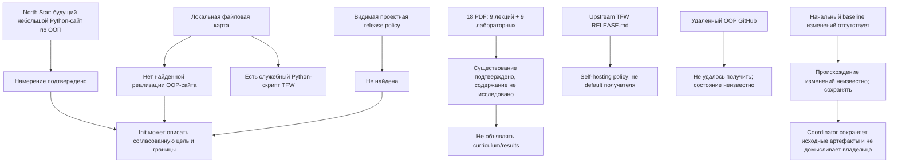

# RES — OOP_20261008-204754_INIT: Исследование проекта перед TFW Full Init

> **Date**: 2026-10-08
> **Author**: Researcher (Codex)
> **Status**: 🔬 RES — Iteration 1 complete; configured minimum not yet met
> **Parent HL**: отсутствует; Full Init предусмотрен отдельным workflow, который не создаёт HL.
> **Mode**: Standalone, focused
> **Producer unit**: Codex thread `01a11c34-f5c1-78e0-85ed-31e05181e193` (`session_meta.id` подтверждён в собственном rollout).
> **Parent Coordinator**: `codex:thread:local:01a11c19-1d6a-72b3-8b7f-c28da8ff3829`
> **Activation / dispatch source**: owner-direct `/tfw-research OOP_20261008-204754_INIT`, переданный через source thread `01a11c19-1d6a-72b3-8b7f-c28da8ff3829`; владелец выбрал `focused` и подтвердил переходы этапов.
> **Coordination authority**: `../../../.tfw/README.md @ sha256:21383c97193ee9b3176464538097eb5525efb30605bed9af2228b1f8ef0d842d` (точная ссылка из `status.md`).
> **Originating proposer**: `none`.

---

## Research Context

Исследование проведено как обязательный Research Gate текущего TFW Full Init. Цель — установить, какие сведения проекта подтверждают корректную инициализацию, а какие нужно оставить неизвестными. Исследовалась локальная рабочая копия на 2026-10-08: HEAD `b95657a3d018f15469efa328eb365cacb0c95747` плюс отличающееся рабочее дерево; этот HEAD не считается ревизией всех изученных файлов. Проверка ограничивалась файлом North Star, настройками TFW, корневыми маршрутами/знаниями, init-следом и файловой картой. Содержимое 18 PDF не изучалось; удалённая копия проекта не была получена.

## Briefing

Использовать цель и границы владельца из [Briefing](1_briefing.md). Владелец подтвердил режим `focused`. Пределы: не реализовывать сайт, не менять лекции/лабораторные, не принимать решения о результатах обучения или будущей архитектуре. Подтверждённые owner decisions для init уже приведены в `work/001/TRACE.md`; данное RES не создаёт альтернативную версию этих решений.

## Decisions

Эти решения описывают исследовательскую трактовку источников для Coordinator; они не устанавливают продуктовую архитектуру и не заменяют решения владельца.

| # | Decision | Rationale |
|---|----------|-----------|
| D1 | Формулировать отсутствие только как «реализация OOP-сайта не найдена в проверенной локальной копии». | В дереве есть `.tfw/economics/tfw_economics.py`, но заголовок определяет его как служебный инструмент TFW, а не приложение курса. Удалённый проект не доступен для проверки. |
| D2 | Считать `.tfw/README.md` подтверждением согласованного намерения, а не описанием уже работающего приложения. | В North Star прямо указаны будущий Python-сайт и открытые детали стека, теста и содержания; инвентаризация не нашла app-specific код/зависимости/команды. |
| D3 | Использовать имена PDF только как сведения о наличии и метаданные тем; не выводить из них заявленные результаты или обязательную программу. | Владелец отложил границы курса; фактическое содержимое PDF в рамках этого исследования не читалось. |
| D4 | Не переносить `RELEASE.md` upstream TFW в политику OOP-проекта и не создавать собственную release policy в рамках Init. | В локальной копии не найдена root `RELEASE.md`; внешний upstream документ ограничивает себя self-hosting TFW и говорит, что это не receiver default. |
| D5 | Не устанавливать автора или основание исходных локальных изменений без подтверждения. | Init-след сообщает, что начальный baseline до предшествующих изменений не сохранён; текущий `git status` этого происхождения не разрешает. |

## Open Questions

| # | Question | Status | Answer |
|---|----------|--------|--------|
| Q1 | Каковы утверждённые результаты обучения, точная программа и границы курса? | Отложено владельцем; вне Init | Владелец ранее направил обсуждение в другой чат; не выводить из PDF-имён. |
| Q2 | Каковы архитектура сайта, библиотеки, mechanics/оценивание теста, сохранение данных и развёртывание? | Открыто; вне текущего объёма | Исследование не нашло app-specific реализацию и не получило решения; отдельное планирование потребуется до реализации. |
| Q3 | Каково происхождение существующих изменений `.tfw/` и untracked материалов курса? | Неизвестно; может влиять на безопасное изменение затронутых файлов | `work/001/TRACE.md` фиксирует отсутствие исходного baseline и требует сохранить/classify changes до связанных операций. Никакой атрибуции здесь не добавлено. |
| Q4 | Что содержится в удалённой GitHub-копии `zetex401/OOP-Course-Mukhitov`? | Не проверено | Открытие адреса вернуло Cache miss, поиск по точному URL — no results. Это не доказывает приватность, отсутствие кода или отсутствие других документов. |
| Q5 | Требуется ли именно для этого standalone-init исследования итерация 2? | Не разрешено; конфигурация требует минимум 2 | `.tfw/project_config.yaml` устанавливает `min_iterations: 2`; Coordinator должен определить/подготовить следующий scope и `research/iterations.yaml` перед следующей pipeline-итерацией. Researcher не создаёт этот файл. |

## Hypotheses (from HL §10)

HL и его §10 в этом init-поручении отсутствуют. Проверяемых HL-гипотез нет; ни одна гипотеза владельцу не приписывается.

## HL Update Recommendations

В данном init-поручении нет HL, поэтому нельзя назначить целевую секцию или предложить изменение HL.

### Refinements — free sections, coordinator applies

**No refinements.** Governing HL отсутствует.

### Amendment Proposals — frozen sections, resolved-ruler verdict required

**No amendment proposals.** Governing HL отсутствует.

## Fact Candidates

Новых human-only фактов о проекте исследование не квалифицирует. Файловые наблюдения доступны через рабочее дерево, а owner decisions уже сохранены в `work/001/TRACE.md`; повторное копирование их в кандидаты не добавит независимой информации.

| # | Category | Candidate | Source | Confidence |
|---|----------|-----------|--------|------------|
| — | — | Нет новых кандидатов. | Инспекция проекта и этой исследовательской итерации; owner decisions остаются в `work/001/TRACE.md`. | — |

## Strategic Insights (Research)

Новых стратегических сведений от владельца в Briefing не поступило. Подтверждения `focused` и переходов — процедурные gate answers; они не считаются новыми проектными ценностями или продуктовыми решениями. Ранее подтверждённые назначение и пределы уже отражены в `work/001/TRACE.md` и `.tfw/README.md`.

## Findings Map

## Iteration Status

- **Iteration:** 1 of 2 (minimum) / 3 (maximum). Следующая итерация не запущена.
- **Hypotheses tested:** Нет — governing HL §10 отсутствует.
- **Hypotheses deferred:** Нет формальных HL hypotheses.
- **Gaps discovered:** точное содержание PDF; curriculum/results и тест; архитектура сайта/зависимости/проверки; удалённое состояние проекта; происхождение изменений; решение о требуемом scope второй итерации.
- **Superseded decisions:** None. Challenge уточнил широкое исследовательское утверждение Gather («не найдено `.py` вообще»), но не менял решения владельца; историю этапа не переписывали.

### Open Threads (for next iteration)

| # | Thread | Why it matters | Suggested focus |
|---|--------|----------------|-----------------|
| 1 | Вторая итерация согласно настроенному `min_iterations: 2` | Без неё нельзя пометить исследование достаточным по текущей конфигурации | Coordinator назначает ограниченный фокус, готовит `research/iterations.yaml` и решает, нужна ли отдельная iter2 в пределах Full Init |
| 2 | Источник изменений и недоступная remote-копия | Сохранение текущих файлов и полнота утверждений об имеющихся материалах | До операций с затронутыми путями сохранять существующее; классифицировать источники только при наличии подтверждения |

### Recommendation

- [ ] **SUFFICIENT** — proceed to `/tfw-plan`
- [x] **MORE NEEDED** — `min_iterations: 2`; Coordinator должен определить/подготовить iter2 и затем решить достаточность. Researcher не создаёт `iterations.yaml` и не расширяет scope без отдельного решения.
- [ ] **BLOCKED**

> Coordinator decides whether to continue or proceed. Researcher recommends but does NOT decide.

## Conclusion

Исследование отделило согласованную цель будущего OOP-сайта от уже существующего содержимого TFW и учебных PDF. Challenge обнаружил скрытый Python-скрипт экономики TFW и сузил первоначальное утверждение: подтверждено лишь то, что app-specific реализация OOP-сайта не найдена в проверенной локальной копии. Наличие учебных материалов установлено по файловой карте, но их содержание не оценивалось; учебные результаты и mechanics теста владелец оставил вне текущего Init. Собственная release-процедура проекта не найдена, а upstream policy для TFW доказуемо не является receiver default. Исследование не устанавливает содержимое удалённой копии и происхождение локальных изменений; эти пробелы остаются явными. Результат помогает Coordinator завершить TFW-настройку без выдумывания продуктовых фактов, но текущая настройка исследования требует минимум ещё одной итерации до рекомендации SUFFICIENT.

### Material handover at this return

- **Producer/unit/parent:** Researcher Codex thread `01a11c34-f5c1-78e0-85ed-31e05181e193`; parent Coordinator route `codex:thread:local:01a11c19-1d6a-72b3-8b7f-c28da8ff3829`; owner `ars`.
- **Source/epoch and inspected scope:** локальный checkout `C:\Users\Арс\.codex\worktrees\dbbc\web-oop-mukhitov`, наблюдался 2026-10-08; Git HEAD `b95657a3d018f15469efa328eb365cacb0c95747`, рабочее дерево содержит отличия. Смотрел root README, `.tfw/README.md`, `KNOWLEDGE.md`, `.tfw/project_config.yaml`, `work/001/TRACE.md`, task status/journal, список файлов материалов, соответствующие Init/Research workflows и TFW economics tool. Содержание PDF не просмотрено; чужой transcript не читался.
- **External sources:** upstream TFW [README](https://github.com/saubakirov/trace-first-starter) и [project-owned `RELEASE.md`](https://github.com/saubakirov/trace-first-starter/blob/master/RELEASE.md), открыты 2026-10-08. Последний документ относится к self-hosting TFW, не к OOP-сайту. Remote OOP URL `https://github.com/zetex401/OOP-Course-Mukhitov` — запрос не загрузился (`Cache miss`); content unavailable, поэтому факты о remote отсутствуют.
- **Material / outcome:** цель сайта описана как план; его реализация локально не обнаружена; присутствуют 18 учебных PDF и собственный Python-инструмент TFW; продуктовая release policy не найдена; происхождение локальных изменений неизвестно. Не создавались проектный код, проверки, release policy, North Star или новые curriculum claims.
- **Uncertainty/owner:** результаты и границы курса, поведение будущего теста, стек/архитектура сайта — решения владельца в отдельном обсуждении. Происхождение изменённых `.tfw/`/untracked материалов остаётся открытым; сохранять без домыслов.
- **Continuation:** Coordinator проверяет этот RES вместе с `1_briefing.md`–`4_challenge.md`, учитывает уточнение про `.tfw/economics/tfw_economics.py`, определяет необходимость/фокус итерации 2 и готовит control file сам, если запускает multi-iteration pipeline. Researcher не меняет HL/TS, source artifacts, status или ранее завершённые этапы.
- **Economics return:** numeric v1 JSONL `economics/roles/researcher_01a11c34-f5c1-78e0-85ed-31e05181e193_r1.jsonl`; revision `1`; SHA-256 `b713fba7dc9ecfc3f83786bff7c29368b852ce4942560829ccee720bff8a5798`; source `codex.rollout:01a11c34-f5c1-78e0-85ed-31e05181e193`, version `0.162.0-alpha.2`, captured JSONL line range `[0,445)`; the bounded source prefix is 2,267,902 bytes, source SHA-256 `6214ba8da45244e25e4c602c0778b04548ab03e0d7fcf97757100079891f05be`; `complete=false`, no full-source coverage asserted. Finite capture cutoff `2026-10-08T21:05:11.020330+05:00` (`2026-10-08T16:05:11.020330Z`). Collector validation succeeded.

---

*RES — OOP_20261008-204754_INIT: Исследование проекта перед TFW Full Init | 2026-10-08*

