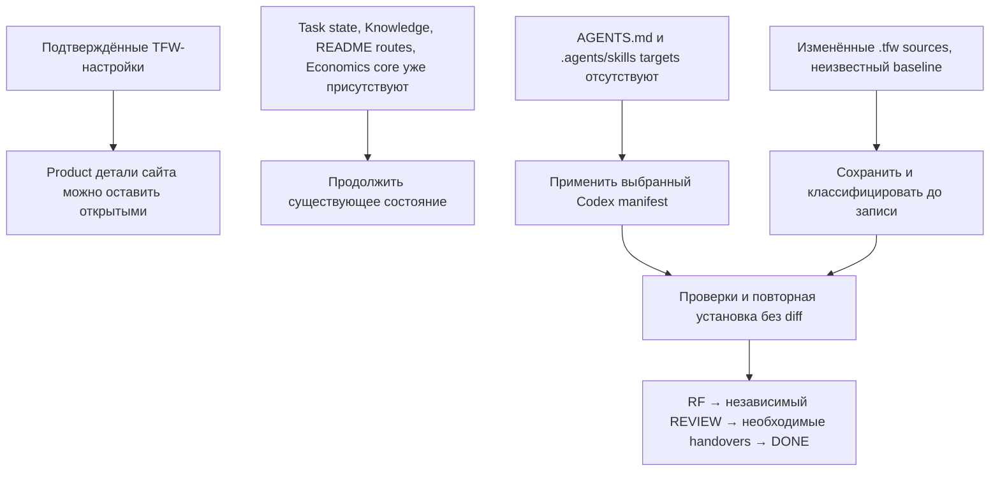

# RES — OOP_20261008-204754_INIT: Исследование предпосылок завершения TFW Full Init

> **Date**: 2026-10-08
> **Author**: Researcher (Codex)
> **Status**: 🔬 RES — Iteration 2 complete; research sufficient, TFW Init postconditions remain
> **Parent HL**: отсутствует; Full Init не создаёт HL.
> **Mode**: Pipeline, focused
> **Producer unit**: Researcher Codex thread `01a11c34-f5c1-78e0-85ed-31e05181e193`.
> **Parent Coordinator**: `codex:thread:local:01a11c19-1d6a-72b3-8b7f-c28da8ff3829`
> **Activation / dispatch source**: owner-direct разрешение владельца продолжить все необходимые действия TFW; конкретная iter2 диспетчеризация от Coordinator в этом же поручении.
> **Coordination authority**: `../../../.tfw/README.md @ sha256:21383c97193ee9b3176464538097eb5525efb30605bed9af2228b1f8ef0d842d`.
> **Originating proposer**: `none`.

---

## Research Context

Проверено, достаточно ли подтверждённых настроек и созданных артефактов для завершения TFW Full Init без домыслов о будущем сайте. Iter1 RES установила цель и границы проекта и оставила открытыми продуктовые детали, baseline/provenance изменённых файлов и необходимость второго прохода. Владелец разрешил все необходимые действия, связанные с завершением TFW, и попросил не вовлекать его в технические термины. Iter2 ограничилась локальными Init-постусловиями и точными проектными файлами; содержимое курса/PDF и архитектура сайта не исследовались. Stage checkpoints сообщались Coordinator; owner-authorized continuation applies.

## Briefing

См. [1_briefing.md](1_briefing.md): H1 — «Для нормального завершения TFW Full Init все необходимые настройки можно определить из уже подтверждённых решений владельца и локальных источников; неизвестные продуктовые детали могут остаться открытыми». Граница исключает product choices и исследование курса.

## Decisions
| # | Decision | Rationale |
|---|----------|-----------|
| D1 | H1 поддерживается: неизвестные детали сайта не мешают определить и завершить настройки TFW. | `.tfw/README.md`, `work/001/TRACE.md`, текущий `project_config.yaml` содержат цель, язык, prefix `OOP`, Codex, контейнер workspace, no Daily и отложенные build/test команды; неизвестные детали явно сохранены открытыми. |
| D2 | Исследовательская часть достаточна; продолжить текущую инициализацию без reset/re-init. | Iter1 и iter2 достигли настроенного `min_iterations: 2`; Init workflow требует сохранять имеющееся состояние и запрещает Full Init поверх настроенного состояния. |
| D3 | Пустые команды проверки, отсутствующий отдельный `RELEASE.md` и отсутствие Daily — допустимы сейчас. | App code отсутствует; Init предписывает не создавать release policy, если её нет, и Daily opt-in не было. |
| D4 | Перед применением Codex adapter targets классифицировать и сохранить изменённые источники; затем проверить route/role/bytes/idempotence по manifest. | `git status --short` показывает существующие изменения `.tfw` и untracked `.tfw/COURSE-MATERIALS`; `TRACE.md` отмечает неизвестное происхождение и требует preservation/classification. |

## Open Questions
| # | Question | Status | Answer |
|---|----------|--------|--------|
| 1 | Нужно ли определить курс, механику теста, стек сайта или deployment для завершения TFW? | Resolved for this Init | Нет; эти детали намеренно отложены и не являются настройками методологии. |
| 2 | Достаточно ли выполнить research gate? | Research resolved; Init open | Да по min_iterations; сам Full Init ещё не завершён. |
| 3 | Какие exact postconditions видимо остаются? | Actionable by Coordinator | Создать managed root `AGENTS.md` и 11 Codex command skills по выбранному manifest после безопасной классификации источников; проверить финальные конфиги/маршруты/idempotence, оформить RF, независимый REVIEW, необходимые handovers/knowledge effects и DONE. |

## Hypotheses (from HL §10)

| # | Hypothesis | HL Status | RES Status | Evidence |
|---|-----------|-----------|------------|----------|
| H1 | Для нормального завершения TFW Full Init все необходимые настройки можно определить из уже подтверждённых решений владельца и локальных источников; неизвестные продуктовые детали могут остаться открытыми. | No HL; delegated hypothesis from Coordinator | ✅ Supported | Iter1 RES; iter2 Gather/Extract/Challenge; local Init workflow, project config, North Star, TRACE and current task artifacts. |

## HL Update Recommendations

Parent HL отсутствует.

### Refinements — free sections, coordinator applies

**No refinements.**

### Amendment Proposals — frozen sections, resolved-ruler verdict required

**No amendment proposals.**

## Fact Candidates

Нет новых human-only кандидатов. Все обнаруженные состояния — проверяемые локальные файлы; owner decisions уже записаны в исходных материалах.

| # | Category | Candidate | Source | Confidence |
|---|----------|-----------|--------|------------|
| — | — | Нет новых кандидатов. | Iter2 локальная инспекция и conversation; см. указанные файлы | — |

## Strategic Insights (Research)

Процедурное owner-разрешение и подтверждение продолжения gate не создают новых продуктовых решений или стратегических сведений.

| # | Category | Insight | Source | Confidence |
|---|----------|---------|--------|------------|
| — | — | No strategic insights. | Итерация 2 | — |

## Findings Map

## Iteration Status

- **Iteration:** 2 of 2 (min) / 3 (max)
- **Hypotheses tested:** H1 — supported
- **Hypotheses deferred:** None
- **Gaps discovered:** отсутствуют обязательные adapter target файлы; не пройдены финальные TFW verification, RF, REVIEW и close; происхождение существующих `.tfw` изменений неизвестно и требует безопасной классификации до связанных записей.
- **Superseded decisions:** None. Iter1 утверждала, что iter2 требуется по min_iterations; эта необходимость теперь выполнена. Iter1 уточнение scope о `.tfw/economics/tfw_economics.py` остаётся в силе.

### Open Threads (for next iteration)

| # | Thread | Why it matters | Suggested focus |
|---|----------|---------------|-----------------|
| — | Нет research threads, требующих третьей итерации | `min_iterations` соблюдён; исследовательский вопрос отвечает на задачу, а оставшееся является исполнением Init workflow | Coordinator продолжает разрешённую настройку; вернуть исследователя только если при применении выявится конкретный блокирующий конфликт/неизвестное. |

### Recommendation
- [x] **SUFFICIENT** — research gate достаточен; Coordinator продолжает Init до RF/review/close
- [ ] **MORE NEEDED**
- [ ] **BLOCKED**

> Coordinator decides whether to continue or proceed. Researcher recommends but does NOT decide.

## Conclusion

Итерация 2 подтверждает, что исследовательских и продуктовых пробелов, мешающих TFW конфигурации, нет: North Star, язык, префикс, Codex, активный контейнер, Daily-off и начальный trace/state уже зафиксированы, а сайт-специфичные неизвестные намеренно остаются открытыми. Сам TFW Init ещё не завершён: сейчас не видны обязательные Codex adapter targets — managed root `AGENTS.md` и skills для 11 manifest-команд — и не выполнены финальные проверки, RF, независимый review и close. Существующие изменённые `.tfw` файлы и `.tfw/COURSE-MATERIALS` нельзя сбрасывать; их следует классифицировать/сохранить перед соответствующей записью. Результат разделяет решение настройки и её незавершённые постусловия. Исследование не применяло adapter, не меняло config/status и не выдавало гипотез о курсе за факт.

### Material handover at this return

- **Producer/unit/parent:** Researcher thread `01a11c34-f5c1-78e0-85ed-31e05181e193`; Coordinator route `codex:thread:local:01a11c19-1d6a-72b3-8b7f-c28da8ff3829`; owner `ars`.
- **Source/epoch and inspected scope:** checkout `C:\Users\Арс\.codex\worktrees\dbbc\web-oop-mukhitov`, 2026-10-08; active task `workspace/2026/OOP_20261008-204754_INIT`. Reviewed Init/research workflows and templates, `project_config.yaml`, init `status.md`/journal, `work/001/TRACE.md`, `team/ars.md`, adapter manifest and Codex sources, README, North Star, KNOWLEDGE, economics core and local status. Did not inspect PDF contents, curriculum, app architecture or remote OOP repository.
- **External source:** official upstream TFW README, https://github.com/saubakirov/trace-first-starter, visited 2026-10-08. It confirms Full has formal research/evidence/review/knowledge gates; used comparatively only. Direct upstream Init page fetch returned cache miss; the local pinned Init workflow governs.
- **Material/outcome:** Iter2 files `1_briefing.md` through `4_challenge.md`; research sufficient. Remaining init handover: safely classify/preserve existing modified sources, install Codex targets exactly from selected manifest, perform Init final verification, RF, independent REVIEW, applicable knowledge effects and DONE. Do not infer remote status or product details.
- **Uncertainty/owner:** user authorized necessary TFW completion actions. Existing local `.tfw/` changes and untracked course materials have unclear prior baseline; preserve. Do not turn `team/ars.md` attribution into authentication.
- **Continuation:** Coordinator resumes the current Init task without reset and follows local `.tfw/workflows/init.md`. If a target conflict is proven and cannot be resolved by preserving/classifying evidence, ask the owner only for that concrete conflict. Researcher stops after this return.
- **Economics return:** numeric v1 JSONL `economics/roles/researcher_01a11c34-f5c1-78e0-85ed-31e05181e193_r2.jsonl`; revision `2`; predecessor file r1, predecessor SHA-256 `b713fba7dc9ecfc3f83786bff7c29368b852ce4942560829ccee720bff8a5798`; output SHA-256 `0b594f9791bafdb8dac0afa38c6f7451c9ffd6bb21475c2f999633e2d7e06a85`; source `codex.rollout:01a11c34-f5c1-78e0-85ed-31e05181e193`, version `0.162.0-alpha.2`, covering line range `[0,772)`, source SHA-256 `d7a3742d02c34d3c215e649f98eef60d0bba6de69a8532ef28a6f4ad43b16897`, source size `3,937,879` bytes; incomplete capture (no complete-source claim). Finite cutoff `2026-10-08T16:13:52.334475Z` / `2026-10-08T21:13:52.334475+05:00`. Collector validation succeeded. Diagnostics record 87 unique-response tokens `9,003,867` reconciled to native thread counter; token_count stream differed and was not added. Unmatched task_started event noted.

---

*RES — OOP_20261008-204754_INIT: Исследование предпосылок завершения TFW Full Init | 2026-10-08*
