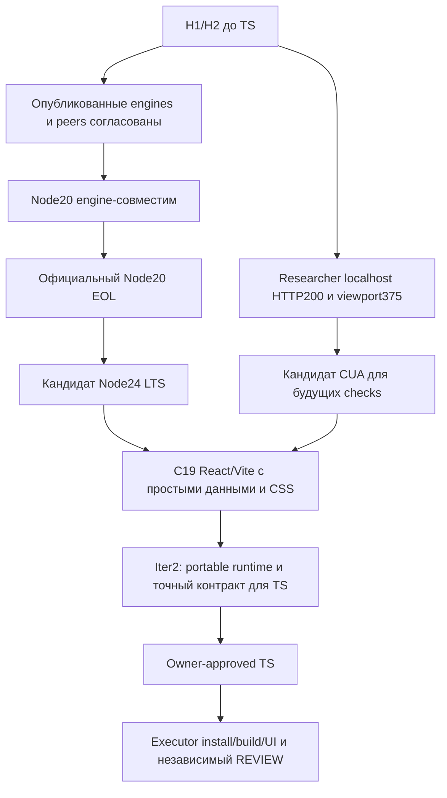

# RES — OOP_20261013-230804_BASE: Совместимость минимального фронтенда и доступность локальных проверок

> **Date**: 2026-10-14
> **Author**: Codex, Researcher
> **Status**: RES — итерация 1 завершена; рекомендуется ограниченная iter2
> **Parent HL**: [HL-OOP_20261013-230804_BASE](../../HL-OOP_20261013-230804_BASE.md) @ f9eee6fdab29a8396df993ab90e3d740186a5738
> **Mode**: Pipeline / focused
> **Producer unit**: codex:thread:local:01a13692-f8c7-77d0-beb8-c487f35251e5
> **Parent Coordinator**: codex:thread:local:01a1366e-05e8-7d93-967e-029096938d9c
> **Activation / dispatch source**: native create_thread; journal/20261013-234303__dispatch__61c0.md @ 093977fd95dc35538d49a13f259944cba3b99605; синтез разрешён journal/20261014-004413__gate_answer__789e.md @ 3685da23cccb07281db30b31f4d764b1b4f95cf5
> **Coordination authority**: HL-OOP_20261013-230804_BASE.md @ f9eee6fdab29a8396df993ab90e3d740186a5738, §4.1
> **Originating proposer**: none
> **Effective routing**: RES; native-gates; tfw-gates-only; selection_ref baseline; upstream owner:ars; фазы нет. Полный status в commit продолжения проверен; исходная authority и unit прежние.

## Research Context

Исследование проверяло H1/H2 до TS: соразмерен ли React/Vite локальному фундаменту из пяти представлений и можно ли доказать обязательные запуск, сборку, переходы и адаптивность доступными средствами. Результат — условная рекомендация минимальной конфигурации и конкретных проверок. Это не выбор утверждённой архитектуры, не готовое приложение и не доказательство ещё не выполненных install/build/UI сценариев. Реализация, продуктовые зависимости, README и материалы курса не создавались и не изменялись.

## Briefing

[1_briefing.md](1_briefing.md) @ 11dd6e1f494d87a3b45bb3329d8d0c3c22638046 задаёт границы и три вопроса: совместимая минимальная конфигурация, доступное доказательство результата и основания зависимостей. Mode focused согласован @093977fd95dc35538d49a13f259944cba3b99605; Briefing @6f1498b70d4830c86e104f95123632766b051e23, Gather @16f10caf8810b4ed8a5a466f584e48a5ef289137, Extract @5ba252bf9f51cd2feb8bde2127a9a7bab93157bb и Challenge @3685da23cccb07281db30b31f4d764b1b4f95cf5 получили вертикальные gate_answer собственного Coordinator. Каждый исследовательский этап включал первичные внешние источники и один focused OODA-проход.

## Decisions

Все решения ниже — исследовательские рекомендации Coordinator до утверждения TS.

| # | Decision | Rationale |
|---|----------|-----------|
| D1 | Рекомендовать C19: React/Vite, Node24 LTS, обычный CSS, простые представления/данные, CUA/IAB для browser checks | Сохраняет предпочтение HL, даёт dev/build/preview, не требует framework-надстроек; Challenge CH6 |
| D2 | Использовать поддерживаемый Node24 как новую portable предпосылку; Node22 LTS остаётся альтернативой | Node20.19.5 engine-совместим, но branch20 EOL; поддержка и package engines — разные утверждения; CH1 |
| D3 | Сохранить кандидат pins React/react-dom19.3.0, Vite8.3.4, plugin-react6.1.2; на исполнении создать lock и проверить чистую установку | Опубликованные registry metadata подтверждают взаимные engines/peers; это ещё не install/build; Extract E1/E3 |
| D4 | Не требовать router, UI kit, state manager, Compiler или Playwright в продукте без конкретной необходимости BASE | Scope и optional peer metadata не обосновывают эти зависимости; E1/E2/E4 |
| D5 | Уточнить до TS простой наблюдаемый URL/state контракт; кандидат — fragment navigation без router library | Нужны согласованные view/URL, reload/back/forward и безопасный unknown fragment; CH2 |
| D6 | Проверять build output через local preview, переходы/клавиатуру по семантике, mobile overflow вместе с видимостью | Dev-only screenshot, наличие пакета и viewport capability недостаточны; CH3–CH5 |

### Evidence and boundaries

На Researcher повторно наблюдены системные Node20.19.5/npm10.8.2; bundled Node24.19.0 и Playwright1.62.1 присутствуют, но browser binaries/запуск Playwright не проверены. Собственный IAB открыл временный loopback HTTP server с HTTP200; viewport375×812 установлен и прочитан. Это конкретно доказывает доступ к localhost и изменение размера в этом unit. Переходы, keyboard focus и адаптивность продукта ещё не существуют; доступ будущих Executor/Reviewer не гарантируется этим наблюдением. Подробности и cleanup — [Gather G3–G5](2_gather.md) @3970a80c94522829cb572a800347ab3182894927.

Публичный read-only npm view подтвердил опубликованные pins и optional peers, сохранённые в [Extract E1](3_extract.md) @50a85803345917a716eb942d5840871fe408e394. Точная package publication отделена от upstream main. Требования Vite совпадают с Node20.19.5 по engines, но [официальный Node Releases](https://nodejs.org/en/about/previous-releases), просмотр2026-10-14, помечает20 EOL и22/24 LTS, latest LTS24.21.0. Поэтому compatibility observation остаётся верной, а рекомендация новой основы использует Node24.

Навигацию без дополнительной библиотеки допускает scope HL; [React conditional rendering](https://react.dev/learn/conditional-rendering), просмотр2026-10-14, описывает выбор JSX обычными условиями. [MDN hashchange](https://developer.mozilla.org/en-US/docs/Web/API/Window/hashchange_event), просмотр2026-10-14, предупреждает, что pushState/replaceState не вызывают hashchange. Отсюда кандидат fragment-контракта, а не уже написанный механизм. [W3C Button Pattern](https://www.w3.org/WAI/ARIA/apg/patterns/button/), просмотр2026-10-14, служит основанием различать link Enter и button Enter/Space. [W3C Reflow](https://www.w3.org/WAI/WCAG22/Understanding/reflow.html) и [Vite local preview](https://vite.dev/guide/static-deploy.html), просмотр2026-10-14, обосновывают ширины320/375/1280 и отдельную проверку dist. Это конкретизация существующих критериев, не требование WCAG сертификации или публикации.

Из 27 сочетаний Extract поддерживаемые runtime оставили C10–C27 условно возможными. C22 vanilla/Vite — сильная альтернатива с меньшим количеством frontend пакетов; достаточного основания сменить предпочтение React не найдено. Варианты без bundler требуют отдельного настоящего build-контракта; открытие файлов не заменяет frozen сборку. Playwright/combined остаются условными альтернативами с дополнительными runtime/OS/binaries предпосылками. Полные пары и survivors — [Challenge](4_challenge.md) @9f27d4611dfb5524d46ce5297fda1e929e10b534.

## Open Questions

| # | Question | Status | Answer |
|---|----------|--------|--------|
| Q1 | Какой точный portable Node24/runtime locator и команды будут описаны для владельца и проверок? | open; предлагается bounded iter2 | Наблюдён bundled24.19.0; official latest LTS24.21.0. Ни системного update, ни portable установки не выполняли |
| Q2 | Какой URL/history/focus контракт и точные oracle переходят в TS? | open; предлагается bounded iter2 | Fragment navigation — кандидат; state-only допустим с честными ограничениями. Окончательное решение Coordinator/owner |
| Q3 | Будут ли install/build и независимые browser checks реально выполнены? | обязательное исполнение после утверждённого TS | Метаданные и Researcher localhost smoke не заменяют результаты Executor/Reviewer; при отсутствии канала требуется возврат Coordinator |

## Hypotheses (from HL §10)

| # | Hypothesis | HL Status | RES Status | Evidence |
|---|-----------|-----------|------------|----------|
| H1 | React с Vite даёт соразмерный локальный фронтенд с запрошенными представлениями и точками расширения | proposed в исходном freeze | supported на уровне соразмерности и metadata; product verification deferred | Gather G1/G2, Extract E1/E2/E3, Challenge CH1/CH6; согласованные peers, flat views, сохранённое предпочтение |
| H2 | Запуск/сборку, навигацию и адаптивность можно проверить доступными локальными средствами без внешней инфраструктуры | proposed в исходном freeze | conditionally supported как канал/план; проверки продукта deferred | Gather G4: HTTP200/viewport; Challenge CH2–CH5: явные oracle; будущие units отдельно подтверждают доступ |

Окончательное «готово/проверено» не заявляется ни для одной гипотезы. Это уровень доказательств исследования, не verdict по отсутствующему продукту.

## HL Update Recommendations

### Refinements — free sections, coordinator applies

| # | § | What to update | Source |
|---|---|----------------|--------|
| R1 | §2 | Сохранить наблюдённые Node20.19.5/npm10.8.2; отдельно указать bundled24.19.0, опубликованные pins и ограниченный localhost/viewport smoke | Gather G3/G4, Extract E1 |
| R2 | §7.2 | Добавить точные official/registry citations из stages с датами и пределами утверждений | Gather G1/G2/G5, Extract E1/E3, Challenge CH1–CH5 |
| R3 | §8 | Разделить portable Node24 readiness, доступ будущих browser units и обязательные install/build/UI результаты; не считать их завершёнными | Challenge CH1/CH5/CH6 |
| R4 | §9 | Уточнить риск EOL20, несовпадения URL/view, утраты focus, clipping вместо reflow и dev-only проверки | Challenge CH1–CH5 |
| R5 | §10 | Обновить H1/H2 на уровень supported/conditional с явной отложенной product verification; ограничить вторую итерацию readiness TS | RES Hypotheses/Q1/Q2 |
| R6 | §11 | Сохранить C19 как условную исследовательскую рекомендацию, C22/C10 как альтернативы, minimal dependencies и разделение product/test runtime | Extract E2/E4, Challenge CH6 |

### Amendment Proposals — frozen sections, resolved-ruler verdict required

**No amendment proposals.** Рекомендации принимаются в существующих границах HL: stack ещё предварительный, точные версии и поведение уточняются до TS, обязательные build/start/navigation/mobile/keyboard и owner acceptance сохраняются. Исследователь не применял ни refinements, ни архитектурные решения.

## Fact Candidates

**No new fact candidates.** История этой роли проверена: новые сообщения — workflow continuation/gate_answer от Coordinator и environment context. Новых человеческих доменных заявлений не поступало. Прежние решения владельца уже находятся в HL §11; не выдаются за новые независимые сведения. Технические версии, package metadata, browser smoke и источники — технические свидетельства, не Human-Only candidates.

## Strategic Insights (Research)

**No strategic insights.** Человеческого доменного обсуждения в исследовательских Briefing не было; техническая рекомендация C19 остаётся в Decisions.

## Findings Map

## Iteration Status

- **Iteration:** 1 of 2 (min) / 3 (max)
- **Hypotheses tested:** H1 — supported как соразмерность/metadata; H2 — conditionally supported как собственный канал и план oracle.
- **Hypotheses deferred:** обе гипотезы не подтверждены на реальном продукте; это обязанность исполнения/независимого REVIEW после TS, не повод начинать код в исследовании.
- **Gaps discovered:** portable Node24 readiness; точный URL/history/focus и evidence contract; future-unit browser availability; product install/build/native binary/UI proof.
- **Superseded decisions:** новых ранее утверждённых решений не заменяли. Engine совместимость20 не отменена; после CH1 Node20 исключён из рекомендации новой runtime-основы из-за EOL. C19 предложен вместо использования только текущего системного runtime.

### Open Threads (for next iteration)

| # | Thread | Why it matters | Suggested focus |
|---|--------|---------------|-----------------|
| 1 | Portable Node24 + точный контракт навигации/доказательств для TS | Иначе инструкция зависит от внутреннего bundled path, а AC могут обещать неподтверждённое history/focus поведение | Coordinator prepares iter2: фиксировать portable версию/locator и команды; уточнить observable URL/history/focus/reflow/build oracle, не повторяя общее сравнение стеков и не реализуя продукт |

### Recommendation

- [ ] **SUFFICIENT** — перейти к TS сейчас
- [x] **MORE NEEDED** — ограниченная вторая итерация по Thread1 и установленному min_iterations2; её scope/control готовит Coordinator
- [ ] **BLOCKED** — непреодолимого blocker текущей итерации не установлено

Install/build и реальные product checks остаются обязательными в исполнении; вторую итерацию не следует превращать в неутверждённую временную реализацию. Архитектуру, TS и соответствующие owner reservations Researcher не утверждает.

## Conclusion

Исследование дало обоснованный минимальный React/Vite-кандидат, подтвердило опубликованные engines/peers и собственный localhost/viewport канал, отделило Node20 EOL от package compatibility и определило проверки, которые простая screenshot или dev-запуск не покрывают. Рекомендуется C19 на Node24 LTS без необоснованных библиотек, затем ограниченная вторая итерация readiness TS. Слабое место результата — отсутствие install/build и продуктовых сценариев: их честно сохраняем как работу исполнения и независимого Reviewer. Ни новый курс, ни продукт, ни архитектурное утверждение в исследовании не создано.

### Own economics at this return

Собственный source namespace `codex.rollout`, source ID `01a13692-f8c7-77d0-beb8-c487f35251e5`, version `0.162.0-alpha.17.2`, файл `C:/Users/Арс/.codex/sessions/2026/10/13/rollout-2026-10-13T23-42-44-01a13692-f8c7-77d0-beb8-c487f35251e5.jsonl`, timezone Asia/Qyzylorda/+05:00. Binding session_meta.id/session_id проверен при входе; текущий capture ограничен диапазоном [0,481) из manifest.

Возвращаемые bytes: [researcher-r6.jsonl](../../economics/researcher-r6.jsonl), revision6, SHA-256 `a451c8136dae161924598c8f09a4b63f5bf0e4e987d33fab25b5cf73b26d408a`, cutoff `2026-10-13T19:52:21.952830+00:00`, complete=false. Штатные collect/validate прошли. Predecessor r5 `9d8d9b9bf9d1d57d0dfd966625301805a6776511107fbc4c168e39d30a30d27b`, исходный captured prefix проверен; covering revisions r1–r6 не суммируются. Числовые stream-discrepancy diagnostics сохранены в manifest. Денежная стоимость не определялась. Ответ и последующие операции после cutoff остаются конечным непокрытым хвостом; open-turn duration не объявлена завершённой.

### Material handover at this return

Producer и единственный получатель указаны в header. Инспектированный scope: утверждённый HL/status/iteration1, полный Briefing/Gather/Extract/Challenge с named commits выше, разрешение синтеза @3685da23cccb07281db30b31f4d764b1b4f95cf5, selected workflow/templates и Current knowledge use/Knowledge handover. Stage sources содержат точные public URL, observed versions/dates и границы собственных наблюдений; raw чужие chats/worktrees/transcripts не читались. Новых knowledge records в доступной копии нет. Материальное: C19 условно поддержан, pins metadata проверены, EOL20 и необходимые oracle сохранены. Неопределённость: Thread1 и все реальные продуктовые проверки. Coordinator применяет free refinements, готовит iter2, затем маршрутизирует owner-approved TS; отсутствие browser/runtime proof не скрывается. Архитектура/TS/код/README/status/iterations.yaml не менялись этой ролью. Scratch/server/npm cache/tab/viewport предыдущих stages очищены, новые temporary files синтеза не создавались.

---

Research iteration 1 complete. Continue with `/tfw-plan OOP_20261013-230804_BASE` to review iterations and decide next step.
