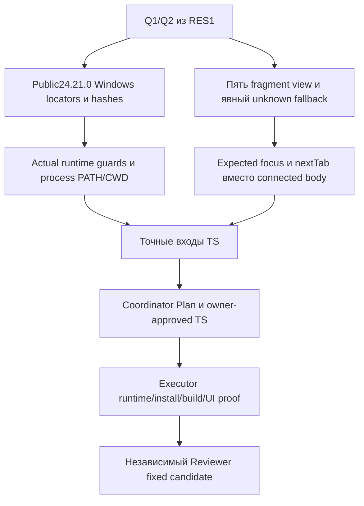

# RES — OOP_20261013-230804_BASE: Готовность входов TS

> **Date**: 2026-10-14
> **Author**: Codex, Researcher
> **Status**: RES — итерация2 завершена; SUFFICIENT для подготовки TS
> **Parent HL**: [HL-OOP_20261013-230804_BASE](../../HL-OOP_20261013-230804_BASE.md); frozen authority f9eee6fdab29a8396df993ab90e3d740186a5738
> **Mode**: Pipeline / focused
> **Producer unit**: codex:thread:local:01a13692-f8c7-77d0-beb8-c487f35251e5
> **Parent Coordinator**: codex:thread:local:01a1366e-05e8-7d93-967e-029096938d9c
> **Activation / dispatch source**: прежний native dispatch той же роли; prepared iter2 handoff @018603bbeab99af17e64a2fe184b74a2de112d68; синтез разрешён journal/20261014-014530__gate_answer__4908.md @d44d7dbb813dbaeacb74078779ddc2b9485bac73
> **Coordination authority**: HL-OOP_20261013-230804_BASE.md @f9eee6fdab29a8396df993ab90e3d740186a5738, §4.1
> **Originating proposer**: none
> **Effective routing**: полный status/control @d44d7dbb813dbaeacb74078779ddc2b9485bac73 проверен; RES, baseline, native-gates, tfw-gates-only, upstream owner:ars; фазы нет; iter1 complete/iter2 pending в Coordinator control. Researcher control/lifecycle не меняет.

## Research Context

Вторая итерация закрыла только Q1/Q2/Thread1 [RES1](../iter1/RES.md) @90439dfa24905073cbd8c707214c66568bb84611: публичную Windows-предпосылку Node24 и наблюдаемый контракт пяти представлений для TS. Общее сравнение стека не повторялось. C19 — React/Vite на поддерживаемом Node24 с обычными CSS/данными и CUA — сохраняется исследовательским кандидатом. SUFFICIENT означает достаточность входов для подготовки и утверждения TS; никакая установка, сборка или проверка отсутствующего продукта не заявлена выполненной.

## Briefing

[Briefing2](1_briefing.md) @03b160e00ef4cdd2898e982da8a331a0b1c268be ограничил исследование public runtime locators/commands и URL/history/focus/reflow/build oracle. Prepared scope @018603bbeab99af17e64a2fe184b74a2de112d68; focused mode @0ef355a318c8226ec75120dc6f40e620b860e9b0; Briefing/Gather gate @61f5e7323bd9ccbef6c30ec45f80b6b5b58b20dd; Gather/Extract @bcfca40c89c1e6de68398bf4f0a479f3cb59df81; Extract/Challenge @394dfb4bc1e9b402139723a7c3353b56c999b153; Challenge/RES @d44d7dbb813dbaeacb74078779ddc2b9485bac73. Каждый stage имел primary external sources, один focused OODA-проход и долговечный вертикальный checkpoint.

## Decisions

Рекомендации до owner-approved TS, не утверждение архитектуры или установки.

| # | Decision | Rationale |
|---|----------|-----------|
| D2.1 | Рекомендовать X11: fixed official Windows ZIP Node24.21.0 по архитектуре + N1 fragments, внутри C19 из RES1 | Фиксированный public locator, нет обязательной persistent system PATH, небольшой конкретный observable контракт; Challenge2 |
| D2.2 | Связать actual public binary, version/arch/execPath и runtime дочерних npm scripts; проверять до ci/build | Print версии без assertion и путь к npm.cmd не гарантируют нужный runtime; CH2.1/CH2.2 |
| D2.3 | Runtime commands должны отказывать при mismatch/error, сохранять/восстанавливать process PATH и CWD | Unexpected20/placeholder/invalid directory/nonzero не становится install proof; CH2.2 |
| D2.4 | Known fragments #home/#materials/#practice/#tests/#results; root/empty/unknown → Главная; unknown URL может сохраниться | Явная known-map и fallback без неоговорённого canonical replaceState; E2.2/CH2.4 |
| D2.5 | Проверять ожидаемый focus target и следующий Tab, не только connected activeElement | Body может быть connected после потери focus; CH2.3 |
| D2.6 | Сохранить exact pins RES1, lock/ci/build/dev+preview и mobile/keyboard oracle как будущий proof | Публичные metadata и capability Researcher не проверяют продукт или доступ Reviewer; E2.4/CH2.5 |

### Q1 — portable prerequisite и пределы наличия

[Official download](https://nodejs.org/en/download) и text [release index](https://nodejs.org/dist/v24.21.0/)/[SHASUMS256](https://nodejs.org/dist/v24.21.0/SHASUMS256.txt), просмотр2026-10-14, подтверждают24.21.0 LTS и Windows ZIP/MSI x64/arm64. Полные locators/hashes — [Gather2 G2.1](2_gather.md) @639a1a79b87edab34033c596be0113df3798724e. Для наблюдённой OSArchitecture X64 fixed ZIP locator: [node-v24.21.0-win-x64.zip](https://nodejs.org/dist/v24.21.0/node-v24.21.0-win-x64.zip), опубликованный SHA-256 `158f7685b44de51f6c0df1d153526cbcd3e1bc739a8dfc607721cef75de9e541`. Binary bytes не получались и не проверялись; locator/hash не объявлены installed runtime.

Системный node этого Researcher остаётся20.19.5/npm10.8.2; bundled24.19.0 не служит portable prerequisite владельца. P2 official MSI и P3 verified existing public24 остаются допустимыми альтернативами при реально разрешённой установке или подтверждённом происхождении/path/version. Actual public directory и npm version пока неизвестны и должны быть наблюдены при исполнении, а не выведены из private bundle.

Кандидат последовательности commands — [Extract2 E2.1](3_extract.md) @4f32cc61635f4a28089871bf16eef89e3a07cbb3 с обязательными уточнениями [Challenge2 CH2.1/CH2.2](4_challenge.md) @7bd556d9434a31612bec0db83324576ea706695f: actual absolute paths, существующие node.exe/npm.cmd, version/path/arch assertions, process-only PATH для scripts, fail-fast exit statuses и directory selection, restoration PATH/CWD после stop/error. На Windows использовать явный npm.cmd; dev5173/preview4173 loopback с strictPort как кандидаты, без скрытой смены URL. Сначала approved Executor создаёт package/lock с pins RES1, затем чистая npm ci/build и реальные dev/preview проверки. Placeholder не исполнялся; PATH не менялся.

Основания: [npm run-script v10](https://docs.npmjs.com/cli/v10/commands/npm-run-script/) и [Microsoft process environment](https://learn.microsoft.com/en-us/powershell/module/microsoft.powershell.core/about/about_environment_variables?view=powershell-7.5), просмотр2026-10-14; [Node24 process docs](https://nodejs.org/docs/latest-v24.x/api/process.html), header24.21.0, просмотр2026-10-14. npm11 run-script URL этим web tool не открылся; реальная npm версия и поведение chosen public runtime остаются execution observation, а не выдуманная проверка.

### Q2 — concrete navigation и proof contract

| Вход/действие | N1 наблюдаемое поведение-кандидат |
|---|---|
| root/empty fragment | Главная, active home, без initial focus hijack |
| initial known fragment/reload | соответствующие view/heading/current |
| CTA начала | Материалы/#materials; четыре будущих раздела явно заглушки |
| top5 links и присутствующие cards | соответствующий known fragment/view/current, настоящие keyboard-доступные элементы |
| back/forward после серии переходов | соответствующее known view; valid focus сохраняется, потерянный переносится в новое содержимое |
| unknown fragment | Главная/current home; unknown URL допускается неизменным, reload сохраняет fallback; no loop/crash |
| повтор текущего раздела | view/current стабильны, focus валиден, лишний jump не требуется |

N1 требует initial resolver независимо от hashchange; replaceState/pushState не дают hashchange автоматически. N2 state-only остаётся альтернативой без обещания сохранения раздела при reload/history; N3 pathname требует server fallback/popstate proof и не имеет текущего основания. Все9 P/N сочетаний совместимы условно, shortlist X11 обоснован в Challenge, альтернативы не скрыты.

Focus: постоянный top-nav инициатор остаётся ожидаемым target; исчезающий CTA/card переводит keyboard focus на новый heading/main, например programmatic target tabindex=-1; initial load не крадёт focus. Проверять именно expected visible target и nextTab, а не только activeElement connected, поскольку body/documentElement может означать отсутствие focus. Ровно один current в наборе top-nav; links Enter, buttons Enter/Space по семантике. Источники и version scopes: MDN Location.hash/hashchange в Gather2, [focus](https://developer.mozilla.org/en-US/docs/Web/API/HTMLElement/focus)/[aria-current](https://developer.mozilla.org/en-US/docs/Web/Accessibility/ARIA/Reference/Attributes/aria-current) в Extract2, [activeElement](https://developer.mozilla.org/en-US/docs/Web/API/Document/activeElement)/[tabindex](https://developer.mozilla.org/en-US/docs/Web/HTML/Reference/Global_attributes/tabindex) в Challenge2; просмотр2026-10-14.

Будущее доказательство существующих DoD: selected public runtime/provenance, clean ci/build exit0, dev и preview dist HTTP+UI; CTA/top5/cards и4 заглушки; keyboard/focus/current; все5 view на320/375/1280 с viewport readback, document width, видимостью текста/nav/контролов и screenshot. Clipping через overflow:hidden не проходит, dev success не равен dist proof. Independent Reviewer открывает fixed candidate и проверяет собственным доступным каналом; Researcher capability не гарантирует доступ других units. Полная evidence table — Extract2 E2.4; это уточнение прежней приёмки, не WCAG сертификация.

## Open Questions

| # | Question | Status | Answer |
|---|----------|--------|--------|
| Q1 (RES1) | Portable Node24 Windows version/locator/commands | closed на уровне research input | Fixed24.21.0 official locators/hash и guarded command sequence есть; actual binary/path/npm и установка принадлежат исполнению |
| Q2 (RES1) | Observable five-view navigation/focus/evidence contract | closed на уровне research input | N1 candidate table/edge cases/expected focus и proof oracle конкретны; Coordinator/owner принимают TS |
| Q3 (RES1) | Реальный install/build/UI и future-unit browser доступ | deferred execution/review obligation | До принятого TS не выполнены; при невозможности — адресный возврат Coordinator, без ослабления DoD |

## Hypotheses (from HL §10)

| # | Hypothesis | HL Status | RES Status | Evidence |
|---|-----------|-----------|------------|----------|
| H1 | React/Vite соразмерен flat views и расширению | supported как соразмерность/metadata после RES1 | supported; public runtime inputs уточнены, product feasibility остаётся execution proof | accepted RES1; Gather2 public locator; guarded sequence Challenge2 |
| H2 | Обязательные локальные сценарии проверяемы без внешней инфраструктуры | conditionally supported как собственный канал/oracle | supported для подготовки точного TS; conditional для реального продукта и доступа future units | RES1 localhost/viewport; Extract2 evidence table; Challenge2 edge checks |

H1/H2 не объявлены окончательно проверенными на продукте. Их смысл не сокращён до package presence или документации.

## HL Update Recommendations

### Refinements — free sections, coordinator applies

| # | § | What to update | Source |
|---|---|----------------|--------|
| R2.1 | §7.2 | Сохранить fixed24.21.0 Windows release/hash, process environment/runtime и focus/current sources с датами/границами | Gather2 G2.1; Extract2 E2.1/E2.3; Challenge2 CH2.1/CH2.3 |
| R2.2 | §8 | Q1/Q2 research inputs готовы; actual public binary/npm/ci/build/UI и собственный канал Executor/Reviewer остаются открытыми обязательствами исполнения | RES2 Open Questions |
| R2.3 | §9 | Уточнить PATH mismatch, version-print без assertion, focus-body, unknown URL, dev-only и clipping risks конкретными oracle | Challenge2 CH2.1–CH2.5 |
| R2.4 | §10 | Отметить завершение двух iter и SUFFICIENT для /tfw-plan; сохранить X11 внутри C19 как рекомендацию, не approved architecture | RES2 Decisions/Iteration Status |

### Amendment Proposals — frozen sections, resolved-ruler verdict required

**No amendment proposals.** Scope, mandatory build/start/transitions/mobile/keyboard, отдельный Reviewer и owner reservations сохраняются. Slugs/guards/widths — кандидатные конкретизации существующего результата до TS, не самостоятельное изменение HL или введение сертификации.

## Fact Candidates

**No new fact candidates.** История этой роли проверена: новые сообщения — Coordinator continuation/gates; человеческих доменных заявлений в iter2 нет. Technical metadata/URLs/version/architecture — свидетельства, не Human-Only candidates. Прежние сведения владельца уже в HL и не дублируются как новые.

## Strategic Insights (Research)

**No strategic insights.** Технические рекомендации не превращены в человеческие strategic insights.

## Findings Map

## Iteration Status

- **Iteration:** 2 of2 (min) /3 (max)
- **Hypotheses tested:** H1 — readiness публичного runtime уточнена; H2 — observable contract/крайние случаи достаточно заданы для TS.
- **Hypotheses deferred:** H1/H2 на реальном продукте и доступ future units остаются execution/review proof после TS; новых отложенных исследовательских гипотез нет.
- **Gaps discovered:** слабые runtime/focus oracle уточнены CH2.1/CH2.3; нерешённого research gap по prepared Q1/Q2 не обнаружено.
- **Superseded decisions:** approved решений не меняли. D2.2/D2.3 уточняют version-print команд Extract, D2.5 уточняет connected-focus oracle; прежние stage bytes сохранены. C19/pins RES1 принимаются без нового общего сравнения.

### Open Threads (for next iteration)

**No open threads** по prepared research scope. Actual runtime/install/build/UI и независимый канал — обязательства реализации/REVIEW, не повод iter3 без нового material gap.

### Recommendation

- [x] **SUFFICIENT** — `/tfw-plan` классифицирует рекомендации, фиксирует точный TS и получает owner approval до исполнения
- [ ] **MORE NEEDED** — нового исследовательского остатка нет
- [ ] **BLOCKED** — blocker синтеза не установлен

Coordinator решает следующий workflow, не Researcher. SUFFICIENT не разрешает download/install/PATH/app/README/TS changes или принятие результата. Две итерации достигнуты; control/lifecycle обновляет Coordinator после получения RES2.

## Conclusion

Prepared Q1/Q2 закрыты: публичная фиксированная Node24 Windows предпосылка больше не зависит от private bundled path, а five-view URL/history/focus/reflow/build контракт имеет конкретные oracle и failure boundaries. Рекомендуется X11 в C19 с сохранёнными альтернативами и точными runtime/focus guards. Исследование не выполнило binary verification, установку, сборку или UI и не гарантирует доступ будущих ролей; эти обязательные результаты принимает независимый REVIEW после approved TS. Для продолжения Plan дополнительных общих исследований сейчас не требуется.

### Own economics at this return

Проверенный диапазон capture: [0,814).

Source namespace `codex.rollout`, source ID `01a13692-f8c7-77d0-beb8-c487f35251e5`, source version `0.162.0-alpha.17.2`; own source `C:/Users/Арс/.codex/sessions/2026/10/13/rollout-2026-10-13T23-42-44-01a13692-f8c7-77d0-beb8-c487f35251e5.jsonl`, session_meta.id/session_id проверены при входе; timezone Asia/Qyzylorda/+05:00. Cumulative bytes обеих итераций: [researcher-r12.jsonl](../../economics/researcher-r12.jsonl), revision12, SHA-256 `c99aba8f98520e05f1b823982dd31f9538c4c48a154a014fe0f0035b034f6df5`, cutoff `2026-10-13T20:51:19.029747+00:00`, complete=false; finite range из manifest. Штатные collect/validate прошли; predecessor r11 `e62db7b2f96c02fbee875fc7371804466e57c4d9b330400bfc6c69da565b19d0` и прежний source prefix проверены. Покрывающие r1–r12 не суммировать. Manifest сохраняет numeric stream discrepancies; стоимость не рассчитывалась, open-turn duration неизвестна. Ответ и операции после cutoff — конечный непокрытый хвост.

### Material handover at this return

Producer/единственный Coordinator recipient/authority указаны выше. Инспектированы полный Briefing2 @03b160e00ef4cdd2898e982da8a331a0b1c268be, Gather2 @639a1a79b87edab34033c596be0113df3798724e, Extract2 @4f32cc61635f4a28089871bf16eef89e3a07cbb3, Challenge2 @7bd556d9434a31612bec0db83324576ea706695f, accepted predecessor RES1, current status/control/gate @d44d7dbb813dbaeacb74078779ddc2b9485bac73 и selected shared knowledge-use/handover правила. Новых knowledge records в копии нет; technical source URLs/dates/epochs находятся в stage и RES2. Material — Q1/Q2 sufficient research inputs, уточнённые guards и expected focus; uncertainty — реальное execution/review proof. Continuation — собственный Coordinator выполняет /tfw-plan и owner approval; Researcher не запускает iter3 или продукт. Чужие чаты/transcripts/unreturned worktrees не читались; code/README/HL/TS/status/control не изменялись. Scratch текущей iter2 не создавался; ресурсы первого smoke ранее очищены.

---

Research iteration 2 complete. Continue with `/tfw-plan OOP_20261013-230804_BASE` to review iterations and decide next step.
