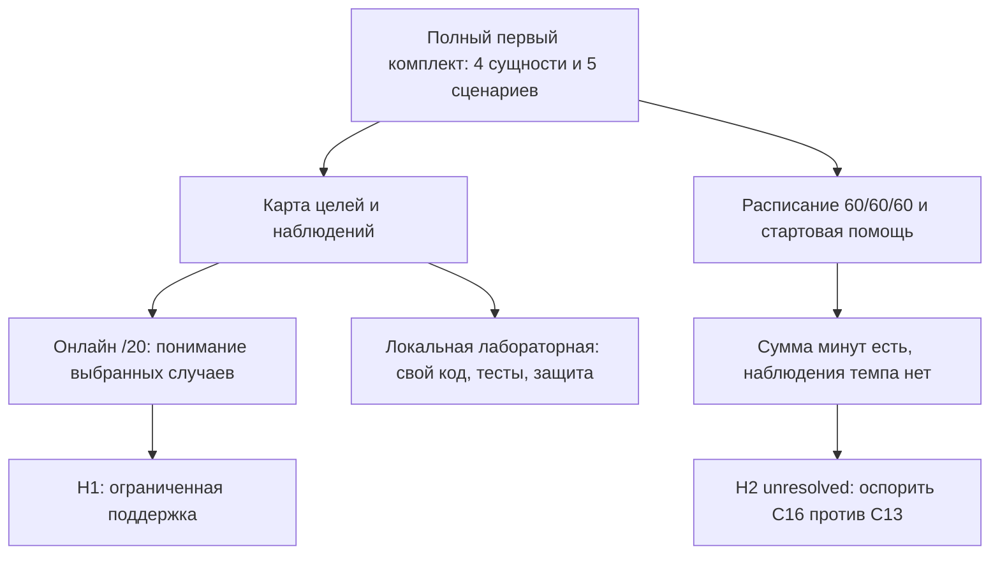

# RES — OOP_20261015-170833_WEEK1: Самопроверка /20 и полный первый комплект 60/60/60

> **Date**: 2026-10-15
> **Author**: Codex, Researcher
> **Status**: RES — iteration 1 complete; MORE NEEDED
> **Parent HL**: [HL](../../HL-OOP_20261015-170833_WEEK1.md) @497dc8907f39c122b63a074823113a2e1c9d0dcc
> **Mode**: Pipeline / focused
> **Producer unit**: codex:thread:local:01a1400a-aec7-7c12-9707-ed85a7f171f1
> **Parent Coordinator / recipient**: codex:thread:local:01a13f7d-7bd4-77f3-9c52-77ec80f172bf
> **Activation / dispatch source**: native command-only delegation; journal/20261015-194947__dispatch__a6b2.md, task baseline 7839b1d54dad6a2e89c5c34701eff9e3cb4fea29; synthesis continuation journal/20261015-200650__gate_answer__fb56.md @4d0ad2752a7bc2593da2f3bf0f9e0d95695118df
> **Coordination authority**: HL-OOP_20261015-170833_WEEK1.md @497dc8907f39c122b63a074823113a2e1c9d0dcc
> **Originating proposer**: none
> **Selection**: journal/20261015-194816__coordination_selected__c5ef.md @497dc8907f39c122b63a074823113a2e1c9d0dcc; native-gates / tfw-gates-only
> **Return state**: iteration complete; task lifecycle remains RES. Iteration 2 not prepared or activated by this Researcher.

## Research Context

Проверены две неопределённости утверждённого HL: что вправе означать автоматическая самопроверка /20 и как сохранить полную лабораторную Avtobys в маршруте из трёх часов. Первая итерация обнаружила пригодное содержание, но несоответствующее новому контракту нынешнее расписание, слабое практическое онлайн-покрытие билета и необходимость отличать расчёт времени от реального прохождения. Результат — ограниченная поддержка H1 и кандидат для последующего оспаривания H2; готовность модуля и выполнение лабораторной студентом не проверялись.

## Briefing

[Briefing](1_briefing.md) @029a84ee891510e04860cdd66cdaf0d1e9c71912 принят gate @7d6b72218b40cc35a6eb394fb74c089ab98252ac. План последовательно охватил цели/обязательные сценарии/нагрузку, карту оценивания/помощи/времени и проверку уязвимостей. Каждый этап завершён отдельным immutable возвратом и принят Coordinator; материалы иных ролей или чужие transcript не читались.

| Этап | Возвращённый источник | Gate разрешения следующего шага |
|---|---|---|
| Gather | [2_gather.md](2_gather.md) @9d4df7c22dff558f129f2ef34ee2ae1496060984 | journal/20261015-200014__gate_answer__949b.md @9c0cb8f451cfe646962b5bc2a8acd4e3b1d5e7e4 |
| Extract | [3_extract.md](3_extract.md) @82296fa92689a52b750b46cead61427157b77c4e | journal/20261015-200334__gate_answer__e8ad.md @95ebf8fbcc70fb07bcae35dec02d71a0d6e4de0b |
| Challenge | [4_challenge.md](4_challenge.md) @30aba632c86395aa48d36f719ff527b717f5d176 | journal/20261015-200650__gate_answer__fb56.md @4d0ad2752a7bc2593da2f3bf0f9e0d95695118df |

Полные исходные PDF (7 страниц лекции, 3 лабораторной) прочитаны текстом и визуально. Точные SHA-256, пути и объём чтения пяти текущих Markdown и двух Python-файлов основной папки сохранены в Gather. Они выбраны как read-only источники по iterations.yaml; dirty bytes не объявлены immutable Git-снимком. Python-файлы просмотрены частично в явно названном объёме, не запускались. Эти пределы распространяются на весь RES.

## Decisions

Исследовательские рекомендации ниже не являются принятием TS, изменением HL или утверждением результата преподавателем.

| # | Decision | Rationale |
|---|----------|-----------|
| D1 | Онлайн /20 обозначает только проверку понимания выбранных случаев; локальная лабораторная и исходная ручная рубрика /20 сохраняют отдельный статус | Матрица Extract E1 и Challenge K1: верный выбор не доказывает написанный код; исходные PDF требуют модель, pytest и защиту |
| D2 | Для дальнейшей проверки использовать 8 базовых баллов и 4 случая по 3 наблюдаемым независимым компонентам | Нынешние /16 имеют только 2 основания на случай; новый знаменатель без новых наблюдений не обоснован. Каждый компонент 0/1 с явно заданным исходным состоянием; сумма 8+12=20 |
| D3 | Практические случаи-кандидаты: ошибочная карта, билет, утечка коллекции Route, переполнение Bus | Билет практически не покрыт прежними случаями; вторую трассу карты заменить билетным случаем без увеличения числа заданий. Полезную трассу карты сохранить как учебный разбор, а не дополнительную оцениваемую задачу |
| D4 | Кандидат для iteration 2 — C16 (D1-B/D2-C/D3-A); контроль — C13 (B/B/A); C27 сохранить как альтернативу | Техническая стартовая помощь и единая онлайн-попытка в практике дают явную границу работы; сравнение с меньшей помощью проверяет её необходимость. Выбор не доказывает эффективность или экономию времени |
| D5 | Не принимать H2 по одной сумме 60+60+60; считать расписание оценкой нагрузки с отсутствующим наблюдением темпа | Extract E4 включает все результаты, но запас завершения/отладки не доказан; перенос попытки между блоками не создаёт времени, Challenge K4 |
| D6 | Не предлагать поправку frozen claims на имеющихся данных; вернуть H2 и условия проверки Coordinator | Не доказаны ни невозможность 180 минут со стартовой помощью, ни достаточность. Самовольное уменьшение контракта, перенос обязательной работы наружу или сужение аудитории не разрешены |

Раздельная оценка означает, что ни онлайн /20, ни зелёный test_reference.py не выдаются за проверку собственной папки domain. Обязательные Route, Bus, TransitCard, SingleTripTicket, все пять исходных тестовых сценариев и ручные 5+7+5+3 сохраняются во всех рекомендациях. Оригинальные PDF и официальные требования сдачи не переписываются.

## Open Questions

| # | Question | Status | Answer |
|---|----------|--------|--------|
| Q1 | Что подтверждает онлайн-балл? | Answered with limits | Выполненные действия по пониманию/трассе/диагностике; не самостоятельную реализацию всех классов. Это соответствие замыслу оценки, не эмпирическая валидация готовых заданий |
| Q2 | Помещается ли полный первый комплект в 180 минут для выбранного новичка? | Unresolved | Есть структурный кандидат, нет измеренного времени и достаточного основания для безусловного обещания |
| Q3 | Достаточна ли помощь C13 или нужны технические helpers C16 без выдачи готовой доменной логики? | Next iteration | Требуется конкретно перечислить «дано/пишет студент», проверить все операции/сценарии и нагрузку |
| Q4 | Есть ли дополнительные требования преподавателя к автоматическому баллу? | Unavailable, not inferred | В прочитанных PDF есть локальные тесты/защита; требования браузерной автооценки кода не обнаружены. Иных указаний не получено |
| Q5 | Готовы ли Python/pytest и базовые знания конкретной группы? | Unknown | Исходные материалы предполагают предварительные навыки. Требуется проверяемая готовность; указание в README не является её свидетельством |

## Hypotheses (from HL §10)

| # | Hypothesis | HL Status | RES Status | Evidence |
|---|-----------|-----------|------------|----------|
| H1 | Вопросы/практические случаи /20 достаточны для ожидаемой самопроверки при отдельной ручной лабораторной | Утверждена ars для исследования 2026-10-15 | Ограниченно поддержана как модель самопроверки понимания; не подтверждение навыка исполнения кода и не результат реального прохождения | PDF-контракт в Gather G1, карта Extract E1–E2, контрпример и ограничения Challenge K1–K3 |
| H2 | Первый комплект адаптируется к 60/60/60 без потери 4 сущностей/5 сценариев | Утверждена ars для исследования 2026-10-15 | Unresolved; найден структурный кандидат, выполнимость не доказана | Прежний неограниченный хвост Gather G2, явный бюджет Extract E4, отсутствие резерва и непроверенные предпосылки Challenge K4–K5 |

## HL Update Recommendations

Researcher классифицирует и не применяет. Свободные уточнения ниже адресованы действующему Coordinator; изменения обязательств frozen-разделов потребуют отдельной действительной процедуры.

### Refinements — free sections, coordinator applies

| # | § | What to update | Source |
|---|---|----------------|--------|
| R1 | §2 | Уточнить: текущее содержание первого комплекта пригодно, но нынешний маршрут включает темы 2–3 и необозначенный по длительности обязательный хвост; /16 и ручная /20 имеют разные основания | Gather G1–G2 |
| R2 | §7.2 | Добавить первичные основания: Python 3.12 §§9.1/9.3/9.6, pytest assertions, CMU alignment/scaffolding/предварительные знания; ограничить перенос на конкретный модуль | Gather G3, Extract E5, Challenge K1/K3; URL ниже |
| R3 | §8 | Зафиксировать требуемую проверку среды и базового Python, конкретной границы стартовой помощи и времени самостоятельной работы; действительные наблюдения группы отсутствуют | Gather G4, Extract E3–E4, Challenge K4 |
| R4 | §9 | Сохранить высокий риск нагрузки; добавить риск принять вспомогательный эталон за собственную лабораторную и риск повысить /16 до /20 без новых независимых наблюдений | Extract E2–E4, Challenge K2–K4 |
| R5 | §10 | H1 — ограниченная поддержка с отдельной лабораторной; H2 — unresolved. Направить следующую итерацию на оспаривание C16/C13, билетного случая и полноты нагрузки, без преждевременного TS | Challenge K1–K6 |

### Amendment Proposals — frozen sections, resolved-ruler verdict required

**No amendment proposals.** Данных для обоснованной смены 180 минут, аудитории или полной лабораторной недостаточно. Это не равнозначно принятию H2. Если анализ покажет необходимое изменение HL §1/§3/§5/§6/§7, Coordinator возвращает evidence/cost/alternative владельцу; нынешний RES такого решения не содержит.

## Fact Candidates

**Новых кандидатов нет.** Проверена доступная история данного Researcher: вход и продолжения поступали от Coordinator; новых прямых человеческих domain-фактов не было. Решения ars уже сохранены в утверждённом HL §11, повторно не выдаются за новые знания. Наблюдения из PDF/файлов — исследовательские свидетельства, а не Human-Only candidates.

## Strategic Insights (Research)

No strategic insights. Нового человеческого контекста в Briefing не получено.

## Findings Map

## Iteration Status

- **Iteration:** 1 of 2 (min) / 3 (max)
- **Hypotheses tested:** H1 — ограниченно поддержана в точной трактовке; H2 — проверена аналитически, unresolved по выполнимости.
- **Hypotheses deferred:** None — обе исследованы; недостающее свидетельство H2 переносится как открытый вопрос, а не пропущенная гипотеза.
- **Gaps discovered:** темп/предпосылки группы; конкретная граница технической помощи; слабое покрытие одноразовости билета нынешними онлайн-случаями; отсутствие самостоятельного основания третьего балла нынешнего /16.
- **Superseded decisions:** None — исходный frozen HL не изменён. Внутри этой итерации после анализа предложено заменить вторую карточную трассу билетным случаем, прежняя версия остаётся в Extract как рассмотренная альтернатива.

### Open Threads (for next iteration)

| # | Thread | Why it matters | Suggested focus |
|---|--------|---------------|-----------------|
| 1 | Достаточность C16 и меньшей помощи C13 | Помощь может незаметно выдавать готовое решение либо оставлять слишком много старта | Явно разделить данное/самостоятельное для всех четырёх сущностей/пяти сценариев; искать минимальную помощь и недостающие операции |
| 2 | Нагрузка и предусловия | Одни подписи 60/60/60 не закрывают DoF о скрытом хвосте | Оспорить бюджет по конкретным действиям, оставить фактическую неизвестность времени честной; при необходимости сформулировать решение владельца |
| 3 | Билет и независимость баллов | Высокий балл иначе почти не проверяет одноразовость/сохранность при просрочке | Проверить карту четырёх случаев и независимые исходные условия трёх частей; проверить ложноположительные толкования результата |

### Recommendation

- [ ] **SUFFICIENT** — к TS на основании одной итерации не переходить.
- [x] **MORE NEEDED** — обязательная iteration 2 с оспариванием кандидата и полноты нагрузки; Coordinator готовит pending entry и продолжает того же Researcher после приёма этого RES.
- [ ] **BLOCKED** — исследование может продолжаться в имеющихся полномочиях; неизвестные факты не подменяются данными.

Coordinator решает дальнейший шаг. Iterations.yaml, HL, status и journal Researcher не менял; iteration 2 не создана самовольно.

## Conclusion

Итерация дала проверяемую границу двух оценок и карту полного обязательного результата, обнаружила слабое практическое покрытие билета и показала, почему изменение знаменателя и перенос квиза между часами не решают задачу качества/нагрузки. C16 с контрольной C13 — исследовательские кандидаты, а не принятое исполнение; H1 поддержана в трактовке самопроверки, H2 остаётся unresolved. Ограничение работы — аналитический характер проверки и неизвестные фактические знания/время группы; внешние методические основания и пример расписания не выданы за эмпирическое доказательство.

### Material handover at this return

Producer, parent, authority и continuation указаны в заголовке. Проверены выбранные Current knowledge use/Knowledge handover и релевантные citations HL §7.2: North Star/KNOWLEDGE/BASE-frontend на исходном task baseline, входящих successor/correction/conflict references к BASE-frontend в knowledge/records не найдено (0_entry @a1cb8bbce3b713504c1ab6b8edd1ed632013965e). Их применение ограничено эпохой каркаса; они не доказывают состояние учебного наполнения. Материальные выводы находятся в Decisions/Hypotheses и stage-источниках с версиями выше. Аналитические контрпримеры не являются исполненными тестами или отзывами. Недоступные указания преподавателя и измерения группы оставлены открыты; владелец ars сохраняет exact TS/denominator, amendments и final acceptance. Получатель — только exact Coordinator; следующий акт — приём RES/economics, применение свободных уточнений и подготовка следующей итерации. HL/TS/код/продукт не изменялись, публикации и сообщения преподавателю не выполнялись.

Основные внешние основания (прочитаны 2026-10-15, точные разделы/ограничения — в этапах): [Python 3.12 Classes](https://docs.python.org/3.12/tutorial/classes.html), [pytest Get Started](https://docs.pytest.org/en/stable/getting-started.html), [pytest assertions](https://docs.pytest.org/en/stable/how-to/assert.html), [CMU alignment](https://www.cmu.edu/teaching/assessment/basics/alignment.html), [CMU scaffolding](https://www.cmu.edu/teaching/solveproblem/strat-criticalthinking/criticalthinking-07.html), [CMU prior knowledge](https://www.cmu.edu/teaching/designteach/teach/priorknowledge.html), [CMU cues](https://www.cmu.edu/teaching/solveproblem/strat-cantapply/cantapply-04.html), [Hou et al. 2023, abstract/metadata only](https://arxiv.org/abs/2311.18115v1).

Рабочие рендеры двух PDF удалены из проверенного системного Temp/tfw после Gather. На остальных этапах scratch не создавался. Собственный bounded economics return приведён ниже.

### Economics contribution

Собственный native source подтверждён session_meta.id = 01a1400a-aec7-7c12-9707-ed85a7f171f1, Codex CLI 0.162.0-alpha.17.2; путь и исходный binding сохранены в 0_entry.md. Чужие источники не включались. Получен и проверен [числовой JSONL](../../economics/roles/1b9fc1bc7913038815318451ce0ed93988f8fb6f7e00ca35592c58b0f5b84966.jsonl), SHA-256 `1b9fc1bc7913038815318451ce0ed93988f8fb6f7e00ca35592c58b0f5b84966`, revision 1, predecessor absent, source range [0,455), source prefix SHA-256 `03b167829b4d1f96044ef1f97696dbefe7990031f8e24bdf114447ba6a4230cb`, finite cutoff `2026-10-15T15:10:01.507808+00:00` (20:10:01 +05:00). Collect / validate / receive PASS; прочитаны фактические сохранённые bytes. Complete относится только к этому конечному префиксу, не ко всему открытому turn/будущим итерациям.

| Наблюдаемая метрика | Значение |
|---|---:|
| Model / effort | gpt-6.1-sol / medium |
| Input | 7 334 683 |
| Cached subset of input | 7 118 848 |
| Fresh input | 215 835 |
| Cache write | 0 |
| Output | 35 683 |
| Reasoning subset of output | 3 792 |
| Total | 7 370 366 |
| Completed-turn duration, 5 закрытых turns | 822.457 s |
| Collector operation | 0.031 s |

Нативные response records: 59 уникальных, сверены с native thread counter. Диагностика collector: token_count 7 141 121 отличается от reconciled response total 7 370 366; выбран response stream, потоки не складывались. Один task_started остаётся без завершения; duration текущего turn неизвестна и не заменяется нулём. Completed-turn duration, wall time исследования и операция collector — разные величины. Цена не оценивалась; числа не являются счётом подписки или всеми расходами WEEK1.

Первый подготовительный вызов capture не получил конечный номер строки: .NET ReadAllLines отказал из-за совместно открытого rollout, после чего CLI отверг отсутствующий аргумент --end. Числовое извлечение в том вызове не началось, корректного диапазона/JSONL и измерения operation time для него нет; он не выдан за measured coverage. Повторный вызов штатного collector сам прочитал полный доступный префикс и вернул приведённый валидный диапазон. Последующие запись/коммит/возврат этого RES и финальный ответ находятся за cutoff; этот конечный хвост объявлен один раз и не вызывает рекурсивного пересбора. При iteration 2 потребуется проверенный successor либо неперекрывающийся срез того же unit; cumulative revisions нельзя складывать.

---

Research iteration 1 complete. Continue with `/tfw-plan` to review iterations and decide next step.

*RES — OOP_20261015-170833_WEEK1 | 2026-10-15*
