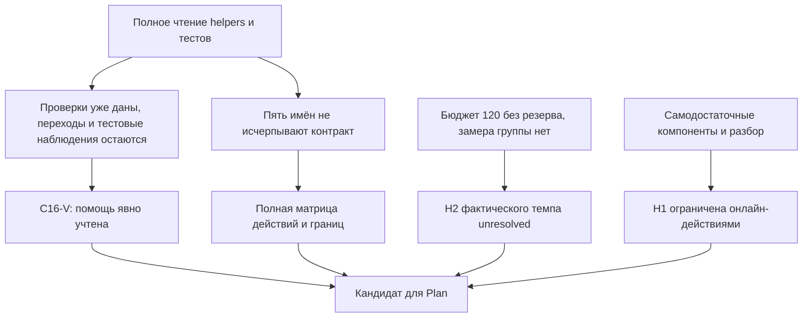

# RES — OOP_20261015-170833_WEEK1: Граница помощи и полнота маршрута

> **Date**: 2026-10-15
> **Author**: Codex, Researcher
> **Status**: RES — iteration 2 complete; SUFFICIENT for Coordinator planning assessment
> **Parent HL**: [HL](../../HL-OOP_20261015-170833_WEEK1.md), selected current @03e10df08e8a6cd7044492fe765b4fe2807e559b
> **Mode**: Pipeline / focused
> **Producer unit**: codex:thread:local:01a1400a-aec7-7c12-9707-ed85a7f171f1
> **Parent Coordinator / recipient**: codex:thread:local:01a13f7d-7bd4-77f3-9c52-77ec80f172bf
> **Activation / dispatch source**: iteration 2 continuation journal/20261015-201336__dispatch__2309.md @f4f173c776e2461f0a97734d15709899fd2f0037; synthesis gate journal/20261015-202622__gate_answer__df1c.md @03e10df08e8a6cd7044492fe765b4fe2807e559b; same unit as initial delegated launch
> **Coordination authority**: HL-OOP_20261015-170833_WEEK1.md @497dc8907f39c122b63a074823113a2e1c9d0dcc
> **Originating proposer**: none; C16-V is Researcher-origin recommendation, not an owner decision
> **Selection**: journal/20261015-194816__coordination_selected__c5ef.md @497dc8907f39c122b63a074823113a2e1c9d0dcc; native-gates / tfw-gates-only
> **Task state at return**: RES; Coordinator-prepared iter2 pending carrier @03e10df08e8a6cd7044492fe765b4fe2807e559b read directly, not edited by Researcher. Frozen scope, audience and owner reservations unchanged.

## Research Context

Вторая итерация оспорила рекомендации [RES iter1](../iter1/RES.md) @4e6aa569834b23983c3bae703e1136e24e9d0733. Уточнено, что именно дают helpers, что остаётся самостоятельной моделью, почему пять названий тестов не исчерпывают полный контракт и что означает отдельный балл практического случая. Получен конкретный кандидат помощи C16-V и карта обязательных действий. Фактическое время группы осталось неизвестным: рекомендация вернуться в Plan означает достаточность предметной информации для решения Coordinator, а не принятие H2, готового TS или модуля.

## Briefing

[Briefing](1_briefing.md) @a8e3c0534b0a57972bb724cbaede977bc8bdb733 задал точный фокус C16/C13, нагрузки и билетных компонентов; predecessor decisions и open threads сохранены, новых гипотез нет. Все четыре этапа прочитаны для синтеза и отдельно приняты действующим Coordinator:

| Этап | Источник | Gate следующего шага |
|---|---|---|
| Briefing | 1_briefing.md @a8e3c0534b0a57972bb724cbaede977bc8bdb733 | journal/20261015-201630__gate_answer__bd8e.md @49e99efffd122c6e22c9c4a7e248de068a8c6395 |
| Gather | [2_gather.md](2_gather.md) @ffe7025fda22f6d9434b0caf90ef64d73611c473 | journal/20261015-201945__gate_answer__e476.md @c7e6dbd02814e3a98a59d887986f9ad0af9c8dbb |
| Extract | [3_extract.md](3_extract.md) @09b287a98936986a67c669992cf32a5bbf13104b | journal/20261015-202305__gate_answer__04bc.md @ef69c745dbccd65f801ca9a2767caf56ce7ca218 |
| Challenge | [4_challenge.md](4_challenge.md) @79ba873d185ce11ce1e8204bc54c0a056b1a2f15 | journal/20261015-202622__gate_answer__df1c.md @03e10df08e8a6cd7044492fe765b4fe2807e559b |

Источники продукта — только read-only материал, выбранный текущим HL/iterations. Семь хешей Markdown/Python основной папки совпали с iter1 Gather; точные SHA-256 и путь сохранены там и в iter2 Gather G2.1. Здесь полный просмотр reference_solution.py/test_reference.py расширил прежний явно частичный scope; полный текст/визуальный просмотр двух PDF относятся к iter1 и не объявлены новым прогоном. Исполнения Python/pytest, браузерных проверок, человеческого прохождения и замера времени в исследовании не было.

## Decisions

Все решения ниже — исследовательские рекомендации в пределах Role Lock. Только Coordinator оценивает их достаточность для Plan; exact TS/denominator и final acceptance принадлежат ars.

| # | Decision | Rationale |
|---|----------|-----------|
| I2-D1 | Рекомендовать C16-V как конкретный кандидат дальнейшего планирования | Одинаковый явно обозначенный набор помощи: каркас/сигнатуры/импорты/показ API и пять готовых валидаторов. Собственные переходы состояния, публичный интерфейс, вызов проверок, тесты/README/защита остаются; доказанная минимальность помощи или экономия минут не заявлены |
| I2-D2 | Не называть все helpers «только техническими» и не запрещать переиспользование автоматически | _text, _decimal, _money, _count, _aware_time уже проверяют значения; при этом исходные материалы дают полный пример TransitCard и не требуют набрать каждую вспомогательную строку с нуля. Нужен честный учёт данного |
| I2-D3 | Сохранить полный контракт и наблюдения сверх пяти названий тестов | Другой Bus, утечка списка, оба block-отказа, сохранность после исключения и прочие принятые границы не исчезают после зелёных пяти имён. Матрица Extract покрывает все четыре конструктора/девять изменяющих методов, чтение состояния, сценарии, сдачу |
| I2-D4 | Поддержать карту 8 базовых баллов + 4×3 отдельных наблюдения; билет содержит три раздельно заданных состояния | Новое допустимое / использованное в другом Bus / новое просроченное состояние не зависят от предыдущего ответа. Правило составного наблюдения требует исход и состояние; один выбор не получает несколько баллов автоматически |
| I2-D5 | H1 ограничена выбранными онлайн-действиями; собственное объяснение/код проверяются в лаборатории/защите | Правильный выбор может сопровождаться неверным свободным объяснением; обратная связь должна показывать правило, но не аттестует произвольный код. Пороговые ярлыки /16 не переносятся без основания |
| I2-D6 | H2 оставить unresolved по фактическому темпу, не путать полноту карты с временем | 5+55+20+10+10+20=120 рабочих минут, резерв 0; дополнительные 10 минут резерва требуют иной обоснованной экономии. Длительности группы и количественный эффект помощи неизвестны |
| I2-D7 | Рекомендовать возврат в Plan без автоматической третьей desk-итерации или нового owner gate | HL §7 принцип 5 отделяет плановые сроки от измеренного темпа. Есть конкретный кандидат/полная карта/честный gap для решения Coordinator и exact TS approval; отсутствие замера само по себе не доказывает frozen change. Это не waiver DoD или самостоятельное принятие H2 |

C13 сохраняется контрольной альтернативой, C16-T — менее полной помощью, C27 — другой формой обучения; ни один не доказан невозможным. C16-V выбран по конкретности доступной помощи и сохранению предметных действий, а не по доказанному превосходству в минутах. Полный готовый эталон плюс его зелёный тестовый набор не выдаются за самостоятельную лабораторную.

## Open Questions

| # | Question | Status | Answer |
|---|----------|--------|--------|
| Q1 | Что именно дано в C16 и что делает студент? | Answered at research level | Перечень пяти валидаторов Gather и полная матрица Extract. Starter/готовые задания не создавались; точное исполнение относится к будущему принятому TS |
| Q2 | Достаточно ли только пяти named tests? | Answered | Нет: они не исчерпывают контракт. Нужны содержательные наблюдения другого Bus/коллекции/сохранности и остальных принятых границ |
| Q3 | Можно ли сохранить 4 случая/20 и сделать билетные части самодостаточными? | Structurally supported | Да: три отдельно заданных исходных состояния и явное одно основание на компонент. Это не психометрическая валидация готового квиза |
| Q4 | Сколько реально занимает полный путь у группы? | Unresolved, no fabricated answer | Нет студенческого наблюдения/замера/проверенных исходных знаний. C16-V не получил эмпирический PASS |
| Q5 | Требуется ли обязательная frozen-поправка? | Not established | Нет доказанной необходимости менять 180 минут/аудиторию/полноту; если конкретное планирование потребует этого, Coordinator направляет отдельное evidence/cost/alternative владельцу |
| Q6 | Нужно ли автоматически ещё одно исследование? | Recommendation to Coordinator | Нет общего поиска ради уверенности; третья итерация оправдана лишь новым конкретным decision-changing источником/вопросом. Следующий обычный шаг — оценка этого RES в Plan |

## Hypotheses (from HL §10)

| # | Hypothesis | HL Status | RES Status | Evidence |
|---|-----------|-----------|------------|----------|
| H1 | Самопроверка вопросами/случаями /20 достаточна при отдельной ручной лабораторной | После iter1 ограниченно поддержана, iter2 проверяет билет/компоненты | Ограниченная поддержка уточнена: выбранные онлайн-действия, прозрачные основания баллов и разбор; не аттестация собственного кода/свободного объяснения | Extract E2.3; Challenge K2.2–K2.3; полный исходный контракт и CMU assessment/rubrics |
| H2 | Первый комплект адаптируется к 60/60/60 без утраты четырёх сущностей и пяти сценариев | После iter1 unresolved, iter2 оспаривает помощь/нагрузку | Структурный кандидат конкретизирован, полнота действий сохранена; фактическая выполнимость/резерв **unresolved**, не confirmed/refuted | Gather G2.2–G2.4; полная матрица и условие резерва Extract E2.1–E2.2; Challenge K2.1/K2.4–K2.5 |

## HL Update Recommendations

### Refinements — free sections, coordinator applies

| # | § | What to update | Source |
|---|---|----------------|--------|
| R1 | §2 | Уточнить состав helpers и expanded read scope: полное чтение двух Python-файлов во второй итерации, без запуска; хеши прежние. Полные пять имён тестов не исчерпывают весь контракт | Gather G2.1–G2.3 |
| R2 | §7.2 | Добавить внешние основания для временных тестовых условий, явных критериев/деятельности; точные URL и границы переноса ниже. Ни один источник не является замером этой группы | Gather G2.4–G2.5, Extract E2.4, Challenge K2.1/K2.4 |
| R3 | §8 | Для последующего планирования явно назвать данную помощь C16-V и сохранённые самостоятельные действия/границы/сдачу по матрице; готовность среды/основ и способ фактической проверки полного маршрута не оставлять под общей строкой «каркас» | Extract E2.1–E2.2; Challenge K2.1/K2.5 |
| R4 | §9 | Сохранить H2 и нулевой резерв как риск, без выдуманной экономии; добавить ложный PASS одних тестовых имён и риск неверно приписать студенту данную в helper проверку | Extract E2.2; Challenge K2.1–K2.4 |
| R5 | §10 | Записать рекомендации C16-V/контроль C13, операционную независимость билетных частей, ограниченную H1 и unresolved фактическую H2. Оценить переход в Plan по полному RES; не назначать автоматически ещё одну общую desk-итерацию | Challenge K2.3–K2.5 |

### Amendment Proposals — frozen sections, resolved-ruler verdict required

**No amendment proposals.** Ни потеря полного результата, ни необходимость другого времени/аудитории на имеющихся свидетельствах не доказаны. H2 не считается принятой из-за отсутствия предложения. Если будущий конкретный план меняет frozen-claim, нужны evidence/cost/considered alternative и действительный owner verdict; данный RES не предоставляет такого полномочия.

## Fact Candidates

Новых кандидатов нет. Доступная история этого Researcher содержит только Coordinator dispatch/gates; новых прямых человеческих domain-сведений во второй итерации не было. Уже записанные решения ars из HL §11 повторно не квалифицируются; наблюдения кода/документов являются источниками исследования.

## Strategic Insights (Research)

No strategic insights. Нового human-only контекста не получено.

## Findings Map

## Iteration Status

- **Iteration:** 2 of 2 (min) / 3 (max)
- **Hypotheses tested:** H1 — ограниченная поддержка уточнена; H2 — структурно оспорена/конкретизирована, unresolved по фактическому времени.
- **Hypotheses deferred:** None; обе исследованы. Неизвестный человеческий темп не объявлен пропущенной гипотезой или измерением.
- **Gaps discovered:** реальные длительности и исходные знания/готовность группы; количественный эффект помощи; валидность будущих точных заданий/интерфейса.
- **Superseded decisions:** I2-D1/I2-D2 уточняют iter1 D4: вместо неопределённого «технического» C16 выбран явно описанный C16-V. Рекомендация iter1 MORE NEEDED выполнена второй итерацией и заменена рекомендацией достаточности для решения Plan. Frozen-решения не изменены, H2 не переведена в PASS.

### Open Threads (for next iteration)

Автоматическая следующая итерация не предлагается. Остаточные вопросы переданы обычному Coordinator-планированию, где он определяет конкретное действие и основание; таблица не создаёт новый dispatch или разрешение исполнения.

| # | Thread | Why it matters | Suggested focus |
|---|--------|---------------|-----------------|
| 1 | Фактический темп/готовность | Нельзя представить план замером или спрятать обязательную работу наружу | Coordinator при оценке достаточности RES/подготовке exact TS явно определяет границу помощи, результаты блоков, проверку полного пути и честно указанное неизвестное |
| 2 | Будущие точные задания и реализация | Карта не гарантирует правильные варианты/баллы/объяснения | Проверить против матрицы и frozen AC в рамках согласованного TS→RF→независимого REVIEW; никаких результатов сейчас не заявляется |

### Recommendation

- [x] **SUFFICIENT** — вернуть в `/tfw-plan` для классификации рекомендаций и решения Coordinator о подготовке TS. Это достаточность исследовательской информации, не принятие H2 или модуля.
- [ ] **MORE NEEDED** — третья общая desk-итерация без нового вопроса/источника не рекомендуется.
- [ ] **BLOCKED** — исследовательская передача выполнена; дальнейшие разрешения/гейты решает Coordinator, owner reservations сохранены.

## Conclusion

Две итерации дали полный прослеживаемый предметный контракт, разграничение онлайн-понимания и собственного кода, конкретную помощь C16-V и основания каждого практического балла. Главный результат второго прохода — helpers уже содержат правила, но их явное предоставление не отменяет самостоятельных переходов/тестов; пять названий не обеспечивают полный контракт, а сумма времени без резерва не доказывает темп. Рекомендуется вернуться в Plan с этими пределами; самокритика — ни фактическое прохождение группы, ни экономия времени, ни готовые задания не проверены, и H2 остаётся unresolved.

### Material handover at this return

Producer/recipient/activation/authority и selected source эпохи указаны выше. Применены Current knowledge use/Knowledge handover; прежние North Star/BASE citations использованы только в их границах, новых relevant records не требовалось. Исследовательские источники сохранены в stage-файлах и predecessor с точным scope/хешами; прежний частичный просмотр не переписан задним числом. Материальные выводы и остаточные неизвестности передаются единственному exact Coordinator. Он оценивает полный RES/economics и дальнейшее действие; нераскрытое мнение другого unit не собиралось. Статус/journal/iterations/HL/TS/продукт Researcher не изменял, scratch во второй итерации не создавался.

Внешние первичные источники, прочитанные 2026-10-15, с точными разделами и ограничениями в этапах: [CMU scaffolding](https://www.cmu.edu/teaching/solveproblem/strat-criticalthinking/criticalthinking-07.html), [Python 3.12 datetime](https://docs.python.org/3.12/library/datetime.html), [pytest monkeypatch](https://docs.pytest.org/en/stable/how-to/monkeypatch.html), [CMU formative/summative](https://www.cmu.edu/teaching/assessment/basics/formative-summative.html), [CMU objectives](https://www.cmu.edu/teaching/designteach/design/learningobjectives.html), [CMU lectures](https://www.cmu.edu/teaching/designteach/teach/instructionalstrategies/lectures.html), [CMU rubrics](https://www.cmu.edu/teaching/assessment/assesslearning/rubrics.html), [CMU prior knowledge](https://www.cmu.edu/teaching/designteach/teach/priorknowledge.html). Они поддерживают способы анализа, не эмпирический PASS группы.

### Economics contribution — cumulative successor

Own source: Codex rollout 01a1400a-aec7-7c12-9707-ed85a7f171f1, CLI 0.162.0-alpha.17.2, точный путь из iter1/0_entry.md; owner ars, role researcher, phase absent. Чужие источники не включены. Возвращены фактические [JSONL bytes](../../economics/roles/e8be23c41bfed822fc44d3481b4e42e9320c89b507841bf3c4bfbfdd9bfaf9bd.jsonl), SHA-256 `e8be23c41bfed822fc44d3481b4e42e9320c89b507841bf3c4bfbfdd9bfaf9bd`, revision 2, range [0,725), cutoff `2026-10-15T15:29:17.842405+00:00` (20:29:17 +05:00), source prefix SHA-256 `885008fa6243c56729aa5c76a86243608ed5e9f8ea3ae95b13de8f76fffe7364`.

Collect / validate / receive PASS. Predecessor r1 `1b9fc1bc7913038815318451ce0ed93988f8fb6f7e00ca35592c58b0f5b84966` сохранён, его [0,455) prefix проверен неизменным по SHA-256 `03b167829b4d1f96044ef1f97696dbefe7990031f8e24bdf114447ba6a4230cb`. Этот covering successor заменяет r1 в итогах, а не складывается с ним. Complete относится только к выбранному физическому префиксу; текущий открытый turn и последующее не покрыты.

| Метрика, cumulative по этому Researcher | Значение |
|---|---:|
| Observed model / effort | gpt-6.1-sol / medium |
| Input | 16 692 931 |
| Cached subset | 16 361 216 |
| Fresh input | 331 715 |
| Cache write | 0 |
| Output | 69 558 |
| Reasoning subset | 9 214 |
| Total | 16 762 489 |
| Native completed-turn duration, 10 закрытых turns | 1 716.295 s |
| Collector operation | 0.047 s |

Диагностика: token_count 16 421 723 отличается от 92 unique-response native thread total 16 762 489; выбран согласованный с native thread counter response stream, потоки не суммированы. Один unmatched task_started остаётся открытым; неизвестная duration текущего turn не заменена нулём. Native duration не равна wall time исследования. Цена не оценена, это не счёт подписки и не все расходы WEEK1.

Temp-копия числового захвата удаляется после проверки; других scratch-файлов во второй итерации не создавалось. Конечные запись/коммит/передача этого RES и финальное сообщение находятся за cutoff; этот хвост раскрыт один раз и не требует рекурсивного пересбора. При новой разрешённой работе нужен новый проверенный successor/disjoint capture.

---

Research iteration 2 complete. Continue with `/tfw-plan` to review iterations and decide next step.

*RES — OOP_20261015-170833_WEEK1 | 2026-10-15*
