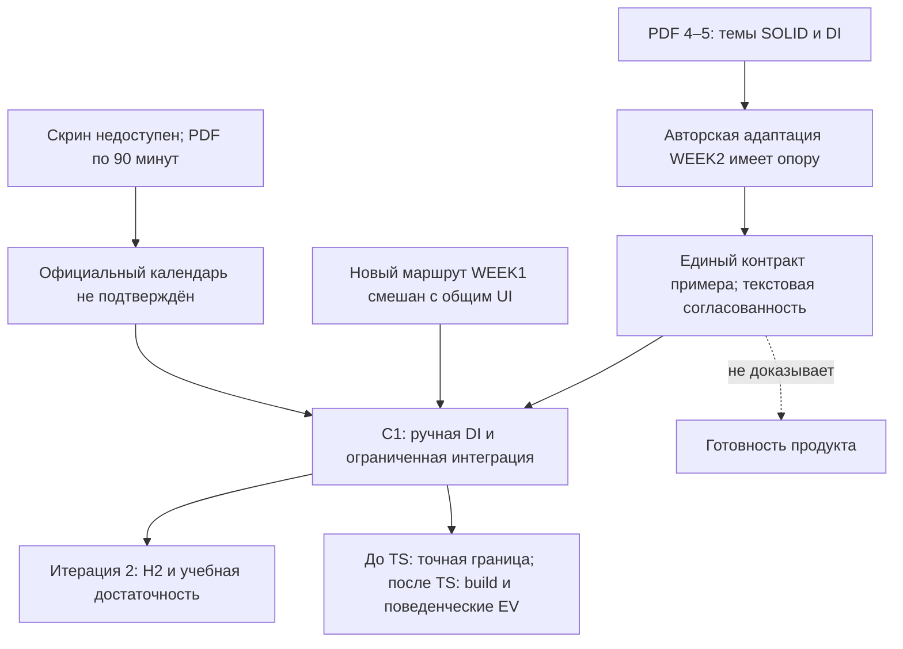

# RES — OOP_20261018-194835_WEEK2: основания SOLID/DI и границы интеграции

> **Date**: 2026-10-19
> **Author**: Codex, Researcher
> **Status**: 🔬 RES — итерация 1 завершена, MORE NEEDED для поручения
> **Parent HL**: [HL-OOP_20261018-194835_WEEK2](../../HL-OOP_20261018-194835_WEEK2.md)
> **Mode**: Pipeline / focused
> **Producer unit**: `codex:thread:local:01a14fe6-b83e-7b91-9916-9d8ebad36666`
> **Parent Coordinator**: `codex:thread:local:01a14f63-57a8-7632-8582-7198710cff4b`
> **Activation / dispatch source**: первоначальный command-first dispatch `journal/20261018-214353__dispatch__2f24.md` @ `cdcc9e5d9073bec640b5fa41e163c29f6518d738`; Synthesis разрешён `journal/20261019-061343__gate_answer__b5c7.md` @ `df94dbf25d6ca70fe7d2b663c9bb993e89165772`.
> **Coordination authority**: `HL-OOP_20261018-194835_WEEK2.md @ e9a75b3e09263fba3591108c92f1e8eb10d6b04d`
> **Originating proposer**: `none`

На возврате действует тот же полный spine: owner ars, lifecycle RES, delegated baseline, coordinator_route равен Parent, upstream_route `owner:ars`, dialogue `tfw-gates-only`, reporting `native-gates`, selection_ref `baseline`; PHASE отсутствует. Governing status и точный gate прочитаны. Разрешение Synthesis не утверждает TS, не принимает продукт и не закрывает H2. Исследователь не менял HL, TS, iterations.yaml, status, journal или код.

## Research Context

Итерация проверяет, дают ли лекции 4–5 содержательную опору авторскому WEEK2 и можно ли завершить его в существующем локальном frontend, сохранив WEEK1. Исходные рабочие изменения рассматриваются как материалы неизвестной готовности. Главный результат — различение тематического основания, авторского расширения, технически необходимой интеграции и дополнительной новой работы WEEK1. Рекомендация C1 ограничивает дальнейшее планирование ручной DI/кратким обзором контейнера, необходимой интеграцией двух недель и честной авторской атрибуцией; она не подменяет будущий TS и проверку результата.

## Briefing

Цель, H1/H3, план и исключения: [1_briefing.md](1_briefing.md) @ `66ff035844067c1784529fc678775bedcc0c53d5`. Завершены и перечитаны перед синтезом:

| Этап | Возвращённый артефакт / immutable ref | Ответ своего Coordinator |
|---|---|---|
| Briefing | [1_briefing.md](1_briefing.md) @ `66ff035844067c1784529fc678775bedcc0c53d5` | Gather разрешён @ `cc3a20dbd4ff22beeb336c1f8fc886b89069c940` |
| Gather | [2_gather.md](2_gather.md) @ `b6e30eb8e8065d68efe710589aa7aaebcc4263e8` | Extract разрешён @ `072b93026135b02cb6c2a7e9493f36298d404d5b` |
| Extract | [3_extract.md](3_extract.md) @ `e914f83af5ae9488326b4efd8a79624042793b8d` | Challenge разрешён @ `cdd4af61cec92a2b4064131b35e726be2b2ef04d` |
| Challenge | [4_challenge.md](4_challenge.md) @ `5939fb0a8a2b6e3f55b6ded8aed793933a1d3bc0` | Synthesis разрешён @ `df94dbf25d6ca70fe7d2b663c9bb993e89165772` |

## Decisions

Это решения исследования и рекомендации Координатору; принятие архитектуры/точного объёма остаётся на предусмотренных gates.

| # | Decision | Rationale |
|---|---|---|
| D1 | Рекомендовать C1: ручная DI с кратким обзором контейнера; принятый WEEK1 плюс необходимая интеграция WEEK2; явный авторский календарный план по PDF | Все темы имеют прямую опору, пример уже использует constructor injection; обязательный контейнер и новый педагогический WEEK1 не оказались необходимыми условиями цели. Challenge K1/K5/K6 |
| D2 | Исправление либо подтверждение категоричных ссылок на недоступный скрин требуется до поставки | Тематический источник не доказывает официальную нумерацию/часовой формат; это выполнение действующих DoD-1/DoF-3, не новое ограничение. Gather G3 |
| D3 | Отделить выбор необходимых изменений от принятия всего исходного bundle; сохранять исходные рабочие байты | Общие App/StudyMaterial смешивают интеграцию WEEK2 и новый основной walkthrough WEEK1. Объём обязан быть обоснован до TS. Extract E4, Challenge K5 |
| D4 | Использовать статическую согласованность как исследовательское основание, а не product PASS | Совпадение файлов/ключей и наличие helpers не доказывают фактические build, browser state/navigation, setup или clipboard. Extract E3/E6, Challenge K3/K4 |
| D5 | Нужна вторая итерация с H2 перед TS; глубокий повтор H1/H3 сейчас не обоснован | Не проверены достаточность учебного перехода к своему тарифу, prerequisites и нагрузка; минимум поручения 2. C19 — альтернатива при доказанной потребности в опциональном подробном контейнере, C4/C5 — при обоснованном включении нового WEEK1 |

### Основания и пределы решений

| Наблюдение | Основание | Что из него не следует |
|---|---|---|
| PDF покрывают SRP/OCP/cohesion/coupling и LSP/ISP/DIP/DI | Gather G2: лекция 4 с. 2–5, лекция 5 с. 2–4; все десять страниц прочитаны и просмотрены | Официальное соответствие календарной неделе 2 и полнота обучения новичка |
| Оба PDF планируют по 90 минут, сайт адаптирует материал к часовой теории | Gather G3; исходная нумерация сохранена | Ни доказанная перегрузка, ни измеренная проходимость 60+60+60 |
| Четыре Python-блока совпадают со скачиваемыми файлами; 20 вопросов/вариантов/ключей согласованы по проверенным текстовым полям | Extract E3: нормализация переводов строк/конечного whitespace; структурная сверка деклараций и Markdown | Корректное копирование из браузера, запуск примера и валидность всех учебных формулировок |
| Предоставленные тесты описывают 14 случаев | Extract E3: AST-счёт 3+4+1+1+1+3+1 | Фактическое «14 passed»: pytest здесь не запускался |
| App держит две попытки выше keyed main и выбирает модель по неделе | Gather G4, Challenge K3 | Наблюдённая независимость UI; нужен сценарий с обеими попытками, переходами и reset |
| Новый WEEK1 walkthrough отсутствует в принятом Candidate; assessment.js WEEK1 ему байт-в-байт равен | Gather G5, Extract E1/E4 | Что весь нынешний WEEK1 уже принят или что новое обучение обязательно для WEEK2 |

Источник PDF 4: `.tfw/COURSE-MATERIALS/01_Лекция_04_SOLID_Часть_1_SRP_и_OCP_Cohesion_Coupling.pdf`, SHA-256 `a5d93e29c2662134825003440538272dba97223f9475e1a40de2e568ee918c16`. Источник PDF 5: `.tfw/COURSE-MATERIALS/01_Лекция_05_SOLID_Часть_2_LSP_ISP_DIP_Dependency_Injection.pdf`, SHA-256 `2cb6f657105cd0ed0404db2675811371c61f498e4cf673606e41676532343e6a`. Оба по пять страниц; содержательная карта и версии — Gather G1/G2. Все 26 выбранных SHA-256 рабочей папки `C:/Users/Арс/OneDrive/Desktop/web-oop-mukhitov` совпали с HL §2.1 при входе и на последующих стадиях; это идентичность входов, не готовый Candidate. Принятый WEEK1 для адресных сравнений — `d7c03d57881084e0215f205adced6fcaa82a1deb`; неизменённый assessment.js имеет SHA-256 `6f2057288986dd93af80a7aff73d9ae4fff5247b25c854349b51b7372ba9c636`.

Внешние основания, прочитанные 2026-10-18/19: constructor injection и разделение сборки/использования — [Fowler, 23 January 2004](https://martinfowler.com/articles/injection.html); причины изменений SRP — [Martin, 8 May 2014](https://blog.cleancoder.com/uncle-bob/2014/05/08/SingleReponsibilityPrinciple.html); отсутствие навязанной runtime-семантики аннотаций Protocol — [PEP 544, Non-goals](https://peps.python.org/pep-0544/); конечность Decimal — [Python 3.12.15](https://docs.python.org/3.12/library/decimal.html#decimal.Decimal.is_finite). Сохранение состояния родителем объясняет [React, v19.3 page](https://react.dev/learn/preserving-and-resetting-state), а условия возможного отказа writeText — [W3C Working Draft, 24 June 2026](https://www.w3.org/TR/2026/WD-clipboard-apis-20260624/). Счёт параметризации сверялся с [pytest documentation](https://docs.pytest.org/en/stable/how-to/parametrize.html), особенности glob — с [Vite documentation](https://vite.dev/guide/features.html#glob-import); поведенческий смысл подтипов — с [авторским CMU abstract Liskov/Wing](https://www.cs.cmu.edu/afs/cs/project/venari/www/subtype-toplas.html), без чтения полного формального текста. Эти источники поддерживают конкретные технические критерии; они не принимают наш продукт и не устанавливают версии пакетов проекта. Точные применения и ограничения — Gather G6, Extract E7 и Challenge «Источники и пределы».

## Open Questions

| # | Question | Status | Answer |
|---|---|---|---|
| Q1 | Достаточен ли самостоятельный переход от предоставленного Bluetooth-примера к своему StudentFareService с тестами и объяснением для выбранного результата обучения? | open — H2, следующая итерация | Техническая точка расширения есть; понятность prerequisites, объём и самостоятельность не установлены. Coordinator готовит pending iteration 2 |
| Q2 | Какая точная граница дополнительных изменений WEEK1 войдёт в TS? | decision pending — Coordinator → ars при утверждении TS | Рекомендован D2-A; D2-B требует отдельного обоснования/проверок. Исходные байты сохраняются, роль не удаляет и не принимает новый walkthrough |
| Q3 | Получены ли фактические свидетельства воспроизводимости практики, двух независимых UI-попыток, сохранения результата и регрессии WEEK1? | not yet — будущие EXEC/REVIEW по утверждённому TS | Нет: здесь выполнялись чтение, hash/diff и статический анализ. Нужные наблюдения сформулированы в Extract E6, пробелы helpers — Challenge K3/K4 |

Недоступный скрин не является блокером авторского варианта C1, но блокирует зависимое утверждение об официальном соответствии. Реальный темп/учебный эффект не измерен; недостающий факт не заменяется оценкой по строкам кода.

## Hypotheses (from HL §10)

| # | Hypothesis | HL Status | RES Status | Evidence |
|---|---|---|---|---|
| H1 | Исходные лекции 4–5 достаточно покрывают SOLID/DI для выбранной авторской недели 2 | open | Поддержана в ограниченном тематическом/техническом смысле; официальный календарь не подтверждён | Gather G2/G3; Extract E2/E3; Challenge K1/K2. Достаточность учебного пути остаётся H2 |
| H3 | WEEK2 можно завершить в нынешнем локальном фронтенде с сохранением WEEK1 | open | Условно поддержана как возможность при ограниченной интеграции; product PASS отсутствует | Gather G4/G5; Extract E4/E6; Challenge K3–K6. Не выявлена необходимость сервера, аккаунтов или browser Python |
| H2 | Теория, предоставленный пример, самостоятельное расширение и самопроверка последовательно проверяют понимание разделения обязанностей и передачи зависимостей | open | Deferred — не целевая гипотеза итерации 1 | Следующая итерация должна проверить prerequisite/нагрузку, самостоятельное действие и критерии; текстовая согласованность её не закрывает |

## HL Update Recommendations

### Refinements — free sections, coordinator applies

| # | § | What to update | Source |
|---|---|---|---|
| R1 | §2 | Заменить «не проверены источники» точным результатом чтения PDF и статической сверки; сохранить отсутствие runtime/UI PASS и наличие смешанной новой работы WEEK1 | Gather G1–G5; Extract E1–E4 |
| R2 | §7.2 | Добавить карту PDF/страниц/хешей и внешние технические основания на их проверенном уровне; сохранить отдельную атрибуцию автора и недоступность скрина | Gather G2/G3/G6; Extract E7; Challenge K1/K2 |
| R3 | §8 | Разделить завершённую проверку тематических источников, открытый H2, решение о точном включении WEEK1 и будущие доказательства на Candidate. Официальный скрин не делать обязательным prerequisite авторского C1 | Challenge K1/K3–K6; Open Questions Q1–Q3 |
| R4 | §9 | Уточнить риски непроверенной атрибуции, сжатого плана, механического включения дополнительного WEEK1 и подмены browser-проверок unit/helper результатами; назвать подходящие наблюдения | Extract E4–E6; Challenge K3–K6 |
| R5 | §10 | Обновить H1/H3 ограниченными RES-status, сохранить H2 open; рассмотреть C1 и условия альтернатив C19/C4/C5, подготовить вторую pending-итерацию H2 до TS | Challenge K6; Hypotheses и Iteration Status этого RES |

### Amendment Proposals — frozen sections, resolved-ruler verdict required

**No amendment proposals.** Найденные уточнения можно принять при текущих §§1, 3–7: цель остаётся модулем SOLID/DI, WEEK1 сохраняется, исходные изменения не теряются, официальные/временные утверждения требуют честного основания. Исправление атрибуции и выбор необходимых включений исполняют существующие условия, не добавляют новое DoF и не меняют frozen-claims. Если последующий выбор действительно меняет заявленный результат, эта роль не разрешает его — потребуется отдельная доказанная proposal с cost/alternative и действующий verdict. Рекомендации выше не применены Исследователем.

## Fact Candidates

**No fact candidates.** История этой роли просмотрена: новых прямых сообщений человека с доменными фактами не было; были командные продолжения и уже сохранённые в HL ограничения. Наблюдения о PDF/коде/тестах доступны агенту по файлам и не проходят Human-Only Test. Они остаются в источниках исследования и могут использоваться будущим tfw-docs по своему evidence level; исходный скрин или учебный эффект не выдумываются.

## Strategic Insights (Research)

**No strategic insights.** Новых человеческих briefings с доменной/стратегической информацией в этой роли не получено. C1 — аналитическая рекомендация из источников, а не приписанное человеку новое стратегическое решение.

## Findings Map

## Iteration Status

- **Iteration:** 1 of 2 (min) / 3 (max, мягкий план Coordinator из iterations.yaml).
- **Hypotheses tested:** H1 — поддержана тематически/технически при авторской адаптации; H3 — поддержана как ограниченная возможность, без product PASS.
- **Hypotheses deferred:** H2 — учебный путь и самостоятельность назначаются следующей подготовленной итерации; реальное время новичка остаётся неизвестным без наблюдения.
- **Gaps discovered:** категоричная атрибуция недоступного скрина; самостоятельный новый результат WEEK1 внутри исходного bundle; отсутствие фактических build/UI/setup/clipboard свидетельств; непроверенная учебная достаточность перехода к тарифу.
- **Superseded decisions:** None — решения предыдущей итерации отсутствуют; рекомендации C1 не заменяют утверждённый HL/TS.

### Open Threads (for next iteration)

| # | Thread | Why it matters | Suggested focus |
|---|---|---|---|
| 1 | H2: теория → предоставленный разбор → собственный тариф → тесты/защита/quiz | Копирование и согласованность файлов не доказывают применение принципа студентом | Проверить prerequisites Protocol/Decimal/pytest, последовательность/объём и критерии самостоятельного действия; время не объявлять измеренным |
| 2 | Минимальная полнота SOLID/DI при часовом авторском плане | Контейнер/правило истории могут быть дополнительными либо необходимыми в зависимости от выбранного действия | Проверить, не стал ли необязательный материал скрытым prerequisite; C19/D1-B рассматривать только при установленной потребности |
| 3 | Граница включения нового WEEK1 и честной атрибуции до TS | Приёмка всего bundle либо удаление входов нарушат ограничения поручения | Coordinator разрешает Q2 и отражает фактический выбор/необходимые доказательства в точном TS для ars; зависимые claims о скрине исправляются либо подтверждаются |

### Recommendation

- [ ] **SUFFICIENT** — proceed to `/tfw-plan` to classify these recommendations and write TS.
- [x] **MORE NEEDED** — первая итерация H1/H3 завершена; нужна итерация 2 H2, поскольку она существенно влияет на самостоятельное действие, объём/критерии и не была проведена. Минимум 2 также задан конфигурацией.
- [ ] **BLOCKED** — общего блокера авторского C1 не обнаружено; отдельное официальное утверждение без скрина остаётся неподтверждённым.

Coordinator решает о продолжении и подготавливает iterations.yaml; Researcher сам не открывает следующую итерацию, не редактирует HL и не пишет TS.

## Conclusion

Итерация дала проверяемую тематическую основу и границу реализации: существующий авторский пример SOLID/DI согласован на уровне источников/текста, а локальный frontend допускает обе недели без новой инфраструктуры. Исследование выявило то, что потерялось бы при механическом принятии рабочих файлов: недоказанную атрибуцию скрина, дополнительный самостоятельный результат WEEK1 и различие между helper/unit проверками и наблюдением полного пути студента. Рекомендован C1 с открытым H2 и обязательными будущими свидетельствами. Ограничение этого вывода существенно: продукт не запускался, темп и учебный эффект не измерены, поэтому RES не принимает Candidate и не заменяет вторую итерацию, исполнение или независимый REVIEW.

### Material handover at this return

Producer — этот Researcher по точному адресу в заголовке; parent — записанный Coordinator. Scope/source epoch — выбранные HL §2.1 байты, PDF с хешами, принятый WEEK1 на указанном Candidate и первичные веб-источники 2026-10-18/19. Детальные inspected scopes и ограничения сохранены в четырёх стадиях; они не заменены сырым transcript. Применены `Current knowledge use` / `Knowledge handover`; поиск входящих successor/correction/conflict ссылок BASE-frontend в knowledge/records снова нашёл только саму запись. Ранний BASE используется в своей области, более позднее принятие WEEK1 — по KNOWLEDGE §1, без переноса приёмки на WEEK2.

Существенное для приёмника: D1–D5, R1–R5 и Q1–Q3. Disposition **owed resolution** — Coordinator классифицирует рекомендации, записывает состояние итерации и готовит итерацию 2 H2; до TS решает границу нового WEEK1 и зависимые claims об источнике. **Unavailable** — скрин и реальные наблюдения темпа; они не переименованы в подтверждённые факты. **Retain-only** — исходные планы/нумерация PDF как исторический контекст, без обязательства превратить их в официальный календарь адаптации. Дополнительные рабочие байты WEEK1 сохранены; их включение/приёмка не решены. Следующее разрешённое действие принадлежит Coordinator через `/tfw-plan`; этот Researcher после возврата останавливается до нового действительного continuation.

### Economics contribution

Собственный source подтверждён по `CODEX_THREAD_ID` и `session_meta.id`: `01a14fe6-b83e-7b91-9916-9d8ebad36666`, Codex `0.163.0-alpha.10.2`. Rollout: `C:/Users/Арс/.codex/sessions/2026/10/18/rollout-2026-10-18T21-44-45-01a14fe6-b83e-7b91-9916-9d8ebad36666.jsonl`; диапазон начинается со строки 0 / `2026-10-18T16:44:45.128Z`, timezone `+05:00` (Asia/Qyzylorda). Собраны, проверены `validate` и приняты `receive` только собственные байты:

| Файл / SHA-256 | Revision / вид | Конечная граница |
|---|---|---|
| [4f79804b230ad374b14a1c5eb889d44a7a60c0ca31fa4340272b43f68c76e93d.jsonl](../../economics/roles/4f79804b230ad374b14a1c5eb889d44a7a60c0ca31fa4340272b43f68c76e93d.jsonl) | 2; measured; 4 компактные daily/model записи; complete=false | Строки `[0,601)`, cutoff `2026-10-19T01:18:31.622567+00:00` / `06:18:31.622567+05:00` |
| [ee36894ace862ca9c89fbe9f273e4537b6ab3b80e0bf6a6accf43391e944d4b3.jsonl](../../economics/roles/ee36894ace862ca9c89fbe9f273e4537b6ab3b80e0bf6a6accf43391e944d4b3.jsonl) | 1; typed `capture_preparation_failed`; без измеренной coverage | Выбранный при записи receipt диапазон `[0,601)`, cutoff `2026-10-19T01:18:31.448933+00:00`; это не восстановленный первоначальный cutoff |

В обеих строках имя до `.jsonl` — полный SHA-256 возвращённых байтов. Measured source prefix SHA-256 `869f82da7a60cd22909bfe0f66902dc666c06287755deb746d270b282a2e6b32`, 5 435 169 bytes. Успешный срез: **input 10 814 112** (fresh 438 432, cached 10 375 680), **output 59 777**, **total 10 873 889**; reasoning 13 888 уже входит в output, cache writes наблюдаются как 0. Модель/effort этого источника — `gpt-6.1-sol/high`, это наблюдение, не выбор будущих запусков. Collector operation — 0.031 s. Duration 1 492.017 s относится к шести завершённым native turns; текущий turn открыт и не имеет завершённой duration. Это не календарная длительность поручения и не сумма времени других ролей.

Diagnostics сохранены: 73 unique-response records согласованы с native thread total 10 873 889; отдельный token_count total 10 573 104 расходится с ним. Выбран первый проверенный поток; два счётчика не складываются. Цена не рассчитывалась: подтверждённый ценовой basis этой ролью не выбирался, подписочная стоимость не выводится из токенов.

Первая подготовительная попытка не дошла до numeric extraction: `.NET File.ReadLines` отказал в совместном доступе к активному rollout, пустой end затем отклонил parser `collect` и parser `failure`. Смена способа чтения на Python позволила привязать конечный диапазон и выполнить обычный collector. Typed receipt фиксирует точную причину и более позднюю наблюдаемую границу, не выдаёт её за исходное измерение. Его operation_seconds null с причиной; он не обнуляет, не заменяет и не добавляется к measured расходу revision 2. Оба файла сохраняются. Временные capture-файлы удалены в том же вызове после получения байтов в task.

Срез конечен: последующая правка этого RES, локальный commit, доставка возврата и финальное сообщение находятся за cutoff. Этот небольшой хвост раскрыт здесь один раз и не запускает рекурсивный пересбор.

---

*RES — OOP_20261018-194835_WEEK2: основания SOLID/DI и границы интеграции | 2026-10-19*
